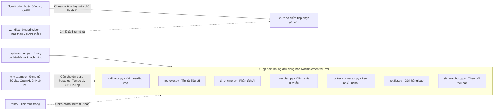
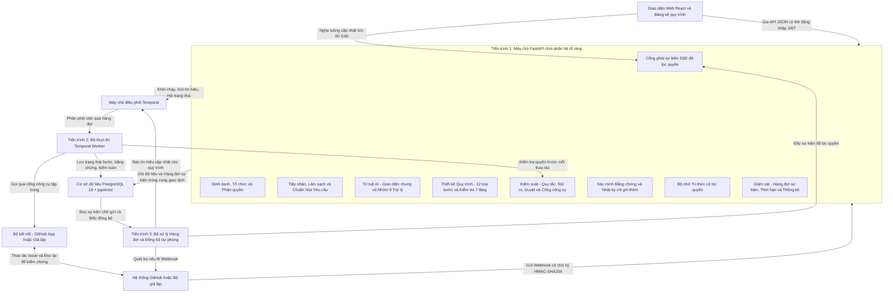
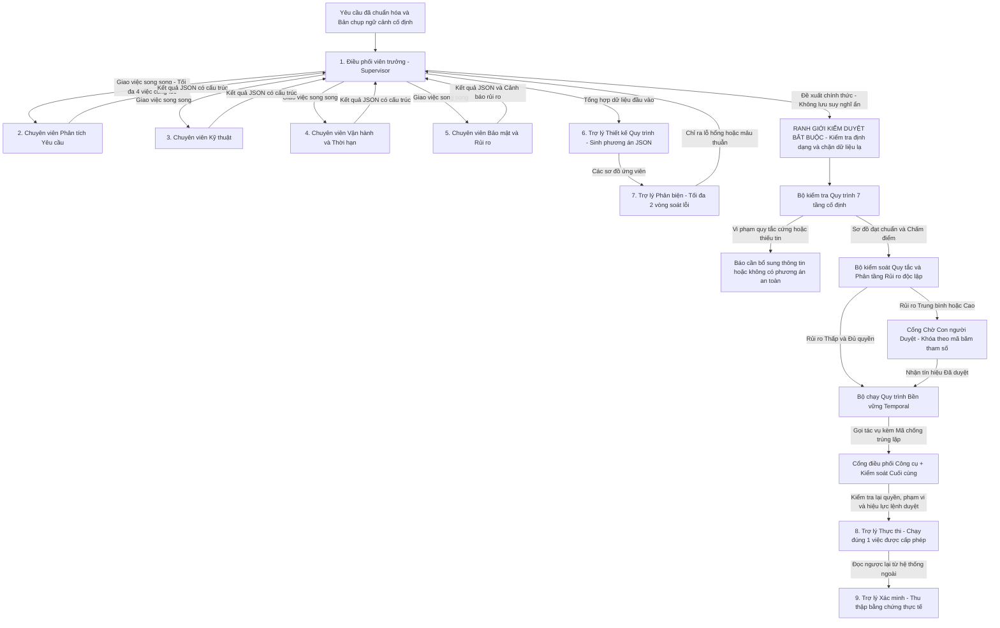
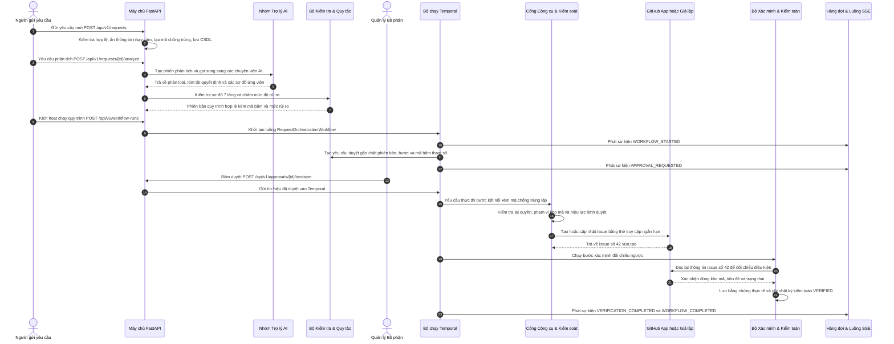
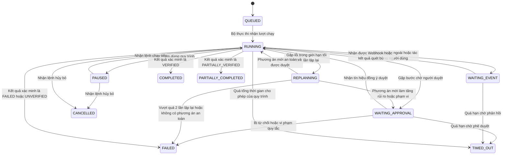
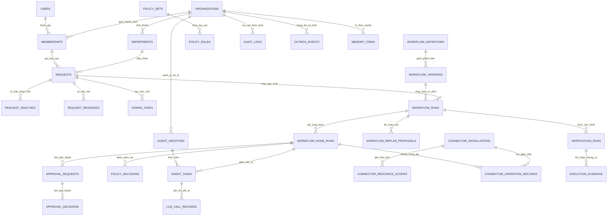

# KẾ HOẠCH TRIỂN KHAI PHẦN XỬ LÝ NỀN (BACKEND) — VADIRAS FLOW

> **Phiên bản tài liệu:** 1.1 (Viết lại hoàn toàn bằng tiếng Việt dễ hiểu)  
> **Cơ sở tham chiếu:** [Vadiras_Flow_Backend_Technical_Spec_v1.md](file:///c:/GitHub/VADIRAS-FLOW/docs/Vadiras_Flow_Backend_Technical_Spec_v1.md) (bản 1.0) và [Antigravity_Master_Prompt_Vadiras_Flow_BE.md](file:///c:/GitHub/VADIRAS-FLOW/docs/Antigravity_Master_Prompt_Vadiras_Flow_BE.md)  
> **Trạng thái kho mã nguồn mục tiêu:** `c:\GitHub\VADIRAS-FLOW` (đã có bộ khung dữ liệu mẫu và các hàm khung chưa cài đặt chi tiết; chưa có kịch bản kiểm thử tự động)

---

## 1. Tổng quan & Nguyên tắc Kiến trúc Cốt lõi

**Vadiras Flow** là nền tảng điều phối và tự động hóa quy trình làm việc trong doanh nghiệp có sự hỗ trợ của trí tuệ nhân tạo (AI). Hệ thống tiếp nhận yêu cầu từ nhân viên nội bộ và khách hàng bên ngoài, phân loại nội dung, điều phối nhóm trợ lý AI chuyên trách (hoạt động trong giới hạn an toàn) để phân tích và đề xuất sơ đồ quy trình, kiểm tra chính sách và rủi ro độc lập, chạy quy trình bền vững qua Temporal, kết nối với hệ thống ngoài (GitHub) qua cổng kiểm soát tập trung, kiểm tra đối chiếu lại kết quả bằng bằng chứng thực tế và lưu nhật ký để học hỏi về sau.

### 1.1 Triết lý & Nguyên tắc Bất biến

- **Triết lý vận hành:** *Hiểu đúng yêu cầu -> Thiết kế quy trình -> Kiểm soát quyền hạn -> Thực thi an toàn -> Đối chiếu bằng chứng -> Rút kinh nghiệm cải tiến.*
- **Nguyên tắc chia vai cốt lõi:** **AI chỉ đề xuất; Bộ kiểm soát quy tắc quyết định cho phép hay chặn; Bộ chạy quy trình thực thi; Bộ xác minh đối chiếu bằng chứng.**
- **Các ranh giới an toàn tuyệt đối:**
  1. Mọi câu trả lời từ AI đều bị xem là **dữ liệu đầu vào chưa đáng tin cậy**; hệ thống phải kiểm tra đúng định dạng và xét duyệt lại bằng quy tắc cố định trước khi làm bất kỳ việc gì.
  2. Tuyệt đối **không** chạy mã lệnh Python, lệnh hệ thống hay `eval` do AI tự viết ra. Quy trình chỉ được phép lắp ghép từ danh sách các bước chuẩn đã đăng ký sẵn trong hệ thống.
  3. Trợ lý AI không được tự cấp quyền cho mình, không được sửa quy định, không được tự duyệt yêu cầu và không được kết nối thẳng vào cơ sở dữ liệu hay mạng bên ngoài — mọi thao tác đều phải qua **Cổng điều phối công cụ tập trung** và **Cổng kiểm soát cuối cùng trước khi thực thi**.
  4. Phần điều phối luồng của Temporal phải cho kết quả **nhất quán tuyệt đối khi chạy lại**; mọi việc gọi cơ sở dữ liệu, gọi mạng, gọi GitHub hoặc gọi AI đều phải tách vào các tác vụ riêng (`Activities`).
  5. Việc hệ thống ngoài trả lời "đã nhận" (mã `2xx`) chưa phải là bằng chứng công việc đã xong — bắt buộc phải có bước **đọc ngược lại dữ liệu thực tế** để đối chiếu.
  6. Dữ liệu nội bộ (ghi chú nội bộ, cảnh báo bảo mật, lịch sử kiểm toán) phải được tách biệt hoàn toàn, không để lọt ra giao diện của khách hàng.

### 1.2 Cấu hình Đã Chốt cho Bản Thử nghiệm Hoàn chỉnh

| Hạng mục | Lựa chọn đã chốt | Cách áp dụng cụ thể |
|---|---|---|
| **Phạm vi tổ chức** | 1 Tổ chức, 6 Phòng ban | `Support` (Hỗ trợ), `Engineering` (Kỹ thuật), `DevOps` (Vận hành hạ tầng), `Security` (An toàn thông tin), `Product` (Sản phẩm), `Management` (Quản lý); mọi bảng dữ liệu đều gắn `organization_id` để sẵn sàng mở rộng |
| **Người gửi yêu cầu** | Nội bộ & Khách hàng | Nhân viên (`EMPLOYEE`) và liên hệ khách hàng (`CUSTOMER_CONTACT` — chỉ xem được các yêu cầu của chính mình) |
| **5 Loại yêu cầu mẫu** | Lõi chung dễ mở rộng | `INCIDENT` (Sự cố/Lỗi), `CHANGE` (Yêu cầu thay đổi), `SERVICE_REQUEST` (Yêu cầu dịch vụ), `ONBOARDING` (Tiếp nhận khách hàng mới), `INTERNAL_TASK` (Việc nội bộ liên phòng ban) |
| **Nền tảng lập trình** | Python 3.11 + FastAPI | Xử lý bất đồng bộ, kiểm tra dữ liệu bằng Pydantic v2, làm việc với CSDL qua SQLAlchemy 2 và Alembic |
| **Bộ chạy quy trình** | Temporal Python SDK | Chạy quy trình dài hạn không bị mất trạng thái khi tắt bật máy chủ; hỗ trợ tạm dừng, tiếp tục, hủy, hẹn giờ và thử lại |
| **Lưu trữ & Tìm kiếm ngữ nghĩa** | PostgreSQL + `pgvector` | Bảng quan hệ chuẩn lưu vòng đời công việc, cột JSONB lưu cấu trúc sơ đồ, tìm kiếm vector có lọc theo tổ chức và quyền xem |
| **AI & Nhóm trợ lý** | Tách khỏi nhà cung cấp cụ thể | Thiết kế lớp giao tiếp chung + bộ giả lập `MockLLMProvider` chạy không cần khóa API; 1 điều phối viên và các trợ lý chuyên trách (chạy song song tối đa 4, soát chéo tối đa 2 vòng) |
| **Kết nối ngoài** | GitHub App + bản giả lập | Chỉ xin quyền tối thiểu (đọc thông tin kho mã, đọc/ghi Issue); nhận sự kiện qua webhook có chữ ký bảo mật và có bộ quét dự phòng định kỳ |
| **Đăng nhập & Phân quyền** | JWT + Argon2id + Quyền theo vai trò và phạm vi | Thẻ đăng nhập ngắn hạn, mã hóa mật khẩu an toàn, kiểm tra lại quyền hiện hành tại mỗi hành động quan trọng, duyệt theo mức độ rủi ro |
| **Cập nhật tức thì & Đóng gói** | SSE + Docker Compose | Đẩy tiến độ theo thời gian thực có lọc quyền; chạy trọn bộ cục bộ bằng Docker Compose (không thêm Redis, Kafka hay Kubernetes) |

### 1.3 Phạm vi Làm và Không Làm trong Bản Thử nghiệm

- **Sẽ làm:** Đầy đủ vòng đời 5 loại yêu cầu; nhóm trợ lý AI 9 vai trò có giới hạn; mô tả quy trình dạng JSON gồm 12 loại bước chuẩn + kiểm tra 7 tầng; chạy bền vững trên Temporal; phân quyền chặt chẽ và ràng buộc lệnh duyệt theo rủi ro; kết nối GitHub App (tạo/đọc/cập nhật/gán/bình luận Issue) kèm bộ giả lập; xác minh đối chiếu ngược với 4 trạng thái rõ ràng; nhật ký kiểm toán chỉ ghi thêm; hàng đợi sự kiện an toàn + luồng SSE; bộ nhớ vector có lọc quyền; thống kê thời hạn, mức độ tự động hóa, chi phí; chạy thử bằng Docker Compose và bộ kiểm thử tự động.
- **Chưa làm:** Tự động triển khai mã lên máy chủ thật; chạy mã lệnh do AI tự sinh; để các AI tự nói chuyện tự do và dùng chung mật khẩu hệ thống; kết nối hàng loạt ERP/CRM/Jira/Slack/Email; đăng nhập SSO doanh nghiệp; tính phí nhiều khách hàng thuê bao; để AI tự sửa quy định hoặc tự huấn luyện lại mô hình.

### 1.4 Quy ước viết chú thích, thuyết minh hàm và thuật toán (Bắt buộc từ Giai đoạn 2 đến Giai đoạn 11)

Để toàn bộ đội ngũ và người đọc mã nguồn dễ theo dõi, bảo trì và đối chiếu nghiệp vụ, mọi mã nguồn mới hoặc chỉnh sửa trong dự án phải tuân thủ quy tắc viết tài liệu nội bộ sau:

1. **Ngôn ngữ chính là tiếng Việt tự nhiên, dễ hiểu:** Toàn bộ dòng chú thích (`# ...`), lời thuyết minh đầu tệp/lớp/hàm (`"""..."""`), mô tả từng bước trong thuật toán và ghi chú cạnh các biến cấu hình đều phải viết bằng **tiếng Việt rõ nghĩa**.
2. **Tránh trộn lẫn từ chuyên môn tiếng Anh khi đã có cách nói tiếng Việt dễ hiểu:** Ví dụ dùng *"kiểm tra đối chiếu lại dữ liệu thực tế"* thay vì *"read-back verification"*, *"cơ chế chống xử lý trùng lặp"* thay vì *"idempotency"*, *"ẩn thông tin cá nhân nhạy cảm"* thay vì *"PII redaction"*, *"cổng kiểm soát trước khi thực thi"* thay vì *"execution guard"*. Chỉ giữ nguyên trong cặp dấu nháy `` `...` `` những tên định danh bắt buộc trùng với mã nguồn (như tên lớp, tên hàm, tên bảng CSDL, đường dẫn API hoặc tên thư viện).
3. **Thuyết minh hàm phải trả lời đủ 3 ý ngắn gọn:**
   - Hàm này dùng để làm gì trong quy trình nghiệp vụ?
   - Đầu vào gồm những gì và có ràng buộc đặc biệt nào không?
   - Kết quả trả về là gì (hoặc gây ra thay đổi nào)?
4. **Giải thích "tại sao" ở các thuật toán phức tạp:** Với các đoạn mã xử lý nhiều bước (như thuật toán kiểm tra đồ thị 7 tầng, thuật toán giải quyết mâu thuẫn giữa các trợ lý AI, thuật toán tính điểm rủi ro, hoặc cơ chế khóa phê duyệt theo mã băm), phải viết chú thích đánh số từng bước ngay phía trên khối lệnh để người đọc hiểu ngay logic mà không cần đoán.

---

## 2. Giai đoạn 0 — Kiểm toán Kho Mã nguồn Hiện tại

### 2.1 Hiện trạng Mã nguồn & Môi trường Đã Kiểm tra Thực tế

- **Lịch sử Git:** Đã có 2 bản ghi (`1586a71 Initial commit`, `7d03009 Bootstrap data contracts and workflow blueprint`) và thư mục `docs/` chưa đưa vào Git (chứa 2 tài liệu đặc tả gốc).
- **Môi trường máy cục bộ:** Python `3.11.9`, quản lý thư viện bằng `pip` và [requirements.txt](file:///c:/GitHub/VADIRAS-FLOW/requirements.txt) (chưa cài `uv` hay `poetry`), `pytest 8.4.2` (hiện có 0 bài kiểm thử), `Docker 28.5.1`, `Docker Compose v2.40.3`.
- **Các tệp hiện có trong `app/`:**
  - [app/__init__.py](file:///c:/GitHub/VADIRAS-FLOW/app/__init__.py): Khởi tạo gói mã nguồn.
  - [app/schemas.py](file:///c:/GitHub/VADIRAS-FLOW/app/schemas.py) (283 dòng): Định nghĩa lớp nền `ContractModel` (chặn trường lạ không khai báo và tự cắt khoảng trắng dư) cùng các cấu trúc dữ liệu ban đầu cho bài toán tiếp nhận phiếu hỗ trợ (`InboundRequest`, `PreprocessedContext`, `AIAnalysisOutput`, `GuardianDecision`, `WorkflowAuditRecord`, `ApprovalActionRequest`, `VerifyResolutionRequest`).
  - **7 tệp khung hàm chưa cài đặt (`NotImplementedError`):** [validator.py](file:///c:/GitHub/VADIRAS-FLOW/app/validator.py), [retriever.py](file:///c:/GitHub/VADIRAS-FLOW/app/retriever.py), [ai_engine.py](file:///c:/GitHub/VADIRAS-FLOW/app/ai_engine.py), [guardian.py](file:///c:/GitHub/VADIRAS-FLOW/app/guardian.py), [ticket_connector.py](file:///c:/GitHub/VADIRAS-FLOW/app/ticket_connector.py), [notifier.py](file:///c:/GitHub/VADIRAS-FLOW/app/notifier.py), [sla_watchdog.py](file:///c:/GitHub/VADIRAS-FLOW/app/sla_watchdog.py).
  - [workflow_blueprint.json](file:///c:/GitHub/VADIRAS-FLOW/workflow_blueprint.json) (80 dòng): Mô tả luồng xử lý thẳng 7 bước trên FastAPI cho đường dẫn `POST /api/v1/requests/ingest`.
  - [requirements.txt](file:///c:/GitHub/VADIRAS-FLOW/requirements.txt): 10 thư viện chưa khóa phiên bản (`fastapi`, `uvicorn[standard]`, `pydantic>=2.0`, `pydantic-settings`, `python-dotenv`, `openai`, `httpx`, `rank-bm25`, `pytest`, `pytest-asyncio`).
  - [.env.example](file:///c:/GitHub/VADIRAS-FLOW/.env.example): Cấu hình mẫu đang trỏ tới SQLite (`vadiraflow.db`), `OPENAI_API_KEY`, và mã cá nhân `GITHUB_TOKEN`.
  - Các thư mục đang để trống (chỉ có `.gitkeep`): `data/`, `prompts/`, `scripts/`, `tests/`, `frontend/`.

### 2.2 Những Điểm Khác biệt Giữa Mã Khởi tạo & Đặc tả — Hướng Điều chỉnh An toàn

| STT | Điểm khác biệt hiện tại | Hướng điều chỉnh ít xáo trộn nhất |
|---|---|---|
| **1** | `.env.example` đang cấu hình dùng tệp SQLite (`vadiraflow.db`), chưa có phần kết nối CSDL và quản lý thay đổi bảng | Chuyển sang **PostgreSQL + `pgvector`** qua thư viện bất đồng bộ SQLAlchemy 2 và Alembic. Giữ nguyên cách đọc cấu hình qua `pydantic-settings` và bổ sung biến cho Postgres, Temporal, JWT. |
| **2** | `workflow_blueprint.json` mô tả luồng xử lý thẳng 7 bước ngay trong FastAPI | Nâng cấp lên **Temporal Python SDK** chạy trên **sơ đồ quy trình dạng nhánh (JSON DAG)** gồm 12 loại bước chuẩn. Giữ tệp `workflow_blueprint.json` lại làm tài liệu tham chiếu/mẫu khởi thủy. |
| **3** | Thư viện chỉ cài `openai`, hàm `analyze_request` chạy đồng bộ, đầu ra có trường `reasoning_trace` | Tạo **lớp giao tiếp AI chung** kèm bộ giả lập `MockLLMProvider` trước; cho phép chọn nhà cung cấp thật qua biến môi trường (`LLM_PROVIDER`). Đổi việc lưu `reasoning_trace` sang tóm tắt quyết định ngắn gọn (`decision_summary`) + dẫn chứng, không lưu hay lộ luồng suy nghĩ nội bộ của AI. |
| **4** | `.env.example` dùng mã cá nhân `GITHUB_TOKEN` | Chuyển sang dùng **GitHub App** (dùng khóa riêng tạo thẻ truy cập ngắn hạn theo từng cài đặt, giới hạn danh sách kho mã được phép truy cập, kiểm tra chữ ký webhook bằng HMAC-SHA256) kèm bộ giả lập `MockGitHubConnector`. |
| **5** | `app/schemas.py` đang thiết kế riêng cho phiếu hỗ trợ khách hàng | Giữ nguyên lớp gốc `ContractModel` (và có thể giữ bộ chuyển đổi tương thích cho đường dẫn tiếp nhận cũ), đồng thời tách cấu trúc dữ liệu theo từng phân hệ trong `app/modules/*/schemas.py` để hỗ trợ đầy đủ 6 phòng ban, 5 loại yêu cầu và phân tách nhân viên với khách hàng. |
| **6** | Thiếu các phần đăng nhập, phân quyền, kiểm soát rủi ro, xác minh bằng chứng, hàng đợi sự kiện, bộ nhớ vector, thống kê và Docker | Xây dựng dần theo kiến trúc **Khối thống nhất chia phân hệ rõ ràng (Modular Monolith)** trong `app/modules/` qua 11 giai đoạn; các tệp khung cũ ở `app/*.py` giữ vai trò cầu nối mỏng hoặc dọn gọn sau khi chuyển hết kiểm thử sang phân hệ mới. |

### 2.3 Bảng Ánh xạ Từ Đặc tả Sang Mã nguồn

| Hạng mục theo Đặc tả | Vị trí hiện tại | Hướng xử lý | Việc cần làm cụ thể |
|---|---|---|---|
| Lớp nền `ContractModel` | `app/schemas.py` | **REUSE** (Dùng lại) | Kế thừa cấu hình chặn trường lạ và cắt khoảng trắng cho mọi mô hình dữ liệu mới |
| Các mô hình phiếu hỗ trợ ban đầu | `app/schemas.py` | **REFACTOR** (Cấu trúc lại) | Mở rộng sang mô hình doanh nghiệp có mã tổ chức, phân biệt nhân viên/khách hàng, 5 loại yêu cầu |
| Bộ kiểm tra và làm sạch đầu vào | `app/validator.py` | **EXTEND** (Mở rộng) | Cài đặt ẩn thông tin cá nhân, tạo mã băm SHA-256 chống trùng, lọc câu lệnh cài cắm (prompt injection) |
| Bộ tìm kiếm tài liệu và phiếu cũ | `app/retriever.py` | **REFACTOR** (Cấu trúc lại) | Chuyển sang tìm kiếm trên `pgvector` kết hợp lọc chặt theo quyền xem và phòng ban |
| Bộ phân tích AI | `app/ai_engine.py` | **REFACTOR** (Cấu trúc lại) | Thay bằng giao diện AI dùng chung, bộ giả lập `MockLLMProvider` và nhóm 9 trợ lý AI chuyên trách |
| Bộ kiểm soát quy tắc và duyệt | `app/guardian.py` | **EXTEND** (Mở rộng) | Nâng cấp thành Bộ kiểm soát quy tắc cố định, phân quyền theo phạm vi, chấm điểm rủi ro, ràng buộc lệnh duyệt và cổng kiểm soát thực thi |
| Bộ kết nối tạo phiếu ngoài | `app/ticket_connector.py` | **REFACTOR** (Cấu trúc lại) | Chuyển thành giao diện kết nối chuẩn cho GitHub App, bộ giả lập GitHub và bảng chống thao tác trùng lặp |
| Bộ gửi thông báo | `app/notifier.py` | **EXTEND** (Mở rộng) | Tích hợp thành bước gửi thông báo trong quy trình và lọc nội dung được phép cho khách hàng xem |
| Bộ theo dõi thời hạn xử lý | `app/sla_watchdog.py` | **EXTEND** (Mở rộng) | Nối với bảng chính sách thời hạn (`sla_policies`), bộ hẹn giờ Temporal và cảnh báo trễ hạn |
| Sơ đồ `workflow_blueprint.json` | Tệp ở thư mục gốc | **REFACTOR** (Cấu trúc lại) | Chuyển thành 5 mẫu sơ đồ quy trình JSON chuẩn 12 loại bước trong `data/workflow_templates/` |
| `requirements.txt` & `.env.example` | Tệp ở thư mục gốc | **EXTEND** (Mở rộng) | Khóa phiên bản các thư viện bổ sung; cập nhật biến môi trường mẫu an toàn (không chứa mật khẩu thật) |
| Quản lý người dùng, tổ chức, phòng ban, tài khoản AI | *(Chưa có)* | **ADD** (Thêm mới) | Xây dựng phân hệ `identity/` và bản nâng cấp CSDL `0001` |
| Thiết kế quy trình, danh mục 12 bước, kiểm tra 7 tầng | *(Chưa có)* | **ADD** (Thêm mới) | Xây dựng phân hệ `workflows/` |
| Bộ chạy quy trình bền vững Temporal | *(Chưa có)* | **ADD** (Thêm mới) | Xây dựng phân hệ `runtime/` và tiến trình chạy nền `temporal-worker` |
| Xác minh bằng chứng & nhật ký kiểm toán | *(Chưa có)* | **ADD** (Thêm mới) | Xây dựng phân hệ `verification/` |
| Hàng đợi sự kiện, luồng cập nhật trực tiếp SSE, thống kê | *(Chưa có)* | **ADD** (Thêm mới) | Xây dựng phân hệ `observability/` và tiến trình `outbox-worker` |
| Docker Compose, Alembic, dữ liệu mẫu, bộ kiểm thử | `tests/`, `scripts/`, `data/` | **ADD** (Thêm mới) | Tạo cấu hình chạy container, tệp tạo dữ liệu mẫu 6 phòng ban / 5 loại yêu cầu, các bộ kiểm thử |
| Đăng nhập SSO doanh nghiệp, tính phí thuê bao, tự sửa máy chủ | *(Ngoài phạm vi)* | **DEFER** (Hoãn lại) | Không nằm trong bản thử nghiệm v1.0 |

---

## 3. Hệ thống Sơ đồ Kiến trúc (Diagram Map Suite)

### Sơ đồ 1 — Kiến trúc Hiện tại của Kho Mã nguồn



### Sơ đồ 2 — Kiến trúc Mục tiêu Tổng thể & Các Tiến trình Chạy Nền



### Sơ đồ 3 — Tổ chức Nhóm Trợ lý AI Giới hạn & Ranh giới Kiểm duyệt Bắt buộc



### Sơ đồ 4 — Luồng Xử lý Đầy đủ Từ Lúc Gửi Yêu cầu Đến Khi Xác minh Hoàn tất



### Sơ đồ 5 — Vòng đời Trạng thái của Một Lượt Chạy Quy trình



### Sơ đồ 6 — Sơ đồ Quan hệ Dữ liệu Cốt lõi (PostgreSQL + pgvector)



### Sơ đồ 7 — Lộ trình Triển khai 11 Giai đoạn & Mốc Chạy Thử Xuyên Suốt

```mermaid
flowchart LR
    P1["Giai đoạn 1: Kiểm toán và Lập kế hoạch - Đã xong"] --> P2["Giai đoạn 2: Nền tảng, CSDL, Nâng cấp bảng, Đăng nhập"]
    P2 --> P3["Giai đoạn 3: Tiếp nhận Yêu cầu và Dữ liệu mẫu"]
    P3 --> P4["Giai đoạn 4: Lớp AI chung, Giả lập AI và Nhóm Trợ lý"]
    P4 --> P5["Giai đoạn 5: Sơ đồ 12 bước, Kiểm tra 7 tầng và Phiên bản"]
    P5 --> P6["Giai đoạn 6: Quy tắc, Rủi ro, Phê duyệt và Cổng công cụ"]
    P6 --> P7["Giai đoạn 7: Bộ chạy Temporal và Chống trùng lặp"]
    P7 --> P8["Giai đoạn 8: GitHub App, Giả lập GitHub và Webhook"]
    P8 --> P9["Giai đoạn 9: Xác minh Bằng chứng và Nhật ký Kiểm toán"]
    P9 --> MVP["MỐC CHẠY THỬ XUYÊN SUỐT ĐẦU-CUỐI - Sự cố và Yêu cầu thay đổi"]
    MVP --> P10["Giai đoạn 10: Bộ nhớ Vector, Thống kê và Luồng SSE"]
    P10 --> P11["Giai đoạn 11: Docker Demo, 10 Kịch bản Kiểm thử và Hướng dẫn"]
```



---

## 4. Cấu trúc Thư mục & Tổ chức Mã nguồn Đề xuất

Giữ toàn bộ phần xử lý nền trong một dự án thống nhất chia phân hệ rõ ràng (phát triển tiếp từ thư mục `app/` hiện có):

```text
c:\GitHub\VADIRAS-FLOW\
├── alembic.ini
├── alembic/
│   ├── env.py
│   └── versions/                          # Các tệp nâng cấp CSDL theo thứ tự 0001..0007
├── app/
│   ├── __init__.py
│   ├── main.py                            # Điểm khởi chạy FastAPI, cấu hình CORS, gắn các tuyến API /api/v1
│   ├── schemas.py                         # [TƯƠNG THÍCH] Giữ lớp gốc ContractModel trong giai đoạn chuyển tiếp
│   ├── core/
│   │   ├── config.py                      # Đọc biến môi trường an toàn (Postgres, Temporal, JWT, AI, GitHub)
│   │   ├── logging.py                     # Ghi nhật ký JSON có che giấu mật khẩu và thông tin nhạy cảm
│   │   ├── security.py                    # Mã hóa mật khẩu Argon2id, tạo/kiểm tra thẻ JWT và chữ ký HMAC
│   │   ├── correlation.py                 # Gắn mã theo dõi xuyên suốt một lượt xử lý
│   │   └── errors.py                      # Định dạng phản hồi lỗi thống nhất cho toàn bộ API
│   ├── db/
│   │   ├── base.py                        # Lớp bảng cơ sở của SQLAlchemy 2
│   │   ├── mixins.py                      # Các cột dùng chung: mã UUID, mã tổ chức, ngày tạo/sửa, người tạo
│   │   └── session.py                     # Kết nối CSDL bất đồng bộ dùng chung
│   └── modules/
│       ├── identity/                      # Người dùng, tổ chức, 6 phòng ban, vai trò và thẻ đăng nhập
│       ├── requests/                      # Tiếp nhận 5 loại yêu cầu, ẩn thông tin nhạy cảm, tách biệt khách hàng
│       ├── ai_intelligence/
│       │   ├── providers/                 # Giao diện AI chung, bộ giả lập MockLLM, bộ nối chuẩn OpenAI
│       │   ├── swarm/                     # Điều phối viên, 9 chuyên viên AI, bộ giải quyết mâu thuẫn
│       │   └── prompts/                   # Đọc mẫu câu lệnh AI theo phiên bản từ thư mục /prompts
│       ├── workflows/
│       │   ├── dsl/                       # Khung dữ liệu 12 loại bước, bộ đọc điều kiện rẽ nhánh an toàn
│       │   ├── registry.py                # Danh mục bước chuẩn và xuất cấu trúc cho React Flow
│       │   ├── validator.py               # Bộ kiểm tra sơ đồ quy trình 7 tầng
│       │   ├── scoring.py                 # Chấm điểm xếp hạng các phương án sơ đồ hợp lệ
│       │   └── router.py                  # API tạo, kiểm tra, ban hành phiên bản quy trình
│       ├── agents/                        # Hồ sơ danh tính AI, năng lực và danh sách công cụ được cấp
│       ├── governance/
│       │   ├── rbac.py                    # Kiểm tra quyền theo vai trò và phạm vi dữ liệu
│       │   ├── policy_engine.py           # Bộ đánh giá quy tắc cố định (cho phép / chặn / cần duyệt)
│       │   ├── risk.py                    # Phân tầng mức độ rủi ro (Thấp / Trung bình / Cao / Nghiêm trọng)
│       │   ├── approvals.py               # Khóa lệnh duyệt theo phiên bản, bước và mã băm tham số
│       │   ├── execution_guard.py         # Cổng kiểm tra lại lần cuối ngay trước khi chạy thao tác ngoài
│       │   └── tool_broker.py             # Cổng điều phối công cụ tập trung (chỉ chạy công cụ trong danh sách)
│       ├── runtime/
│       │   ├── temporal_client.py         # Kết nối tới máy chủ Temporal
│       │   ├── workflows.py               # Định nghĩa luồng chạy DAG nhất quán (không chứa gọi mạng/CSDL)
│       │   ├── activities.py              # Các tác vụ gọi CSDL, AI, Bộ quy tắc, Kết nối ngoài, Xác minh
│       │   ├── state_machine.py           # Kiểm tra chuyển trạng thái hợp lệ và giới hạn lập lại tối đa 2 lần
│       │   └── worker.py                  # Tệp khởi chạy tiến trình temporal-worker
│       ├── connectors/
│       │   ├── base.py                    # Khuôn mẫu chung cho mọi bộ kết nối hệ thống ngoài
│       │   ├── github_app.py              # Kết nối GitHub App dùng thẻ ngắn hạn và danh sách kho cho phép
│       │   ├── mock_github.py             # Bộ giả lập GitHub (hỗ trợ kịch bản thành công, lỗi mạng, trùng lặp)
│       │   ├── webhook_inbox.py           # Xác thực chữ ký thô HMAC-SHA256 và lưu hộp thư chống nhận trùng
│       │   └── reconciler.py              # Bộ quét đồng bộ dự phòng khi mất kết nối Webhook
│       ├── verification/
│       │   ├── engine.py                  # Đánh giá điều kiện hoàn tất (4 trạng thái kết quả rõ ràng)
│       │   ├── evidence.py                # Thu thập bằng chứng đối chiếu ngược và kiểm tra độ mới của dữ liệu
│       │   └── audit.py                   # Ghi nhật ký kiểm toán chỉ được phép thêm mới
│       ├── observability/
│       │   ├── events.py                  # Tạo cấu trúc sự kiện hệ thống chuẩn
│       │   ├── outbox.py                  # Bộ ghi và tiến trình outbox-worker đẩy sự kiện an toàn
│       │   ├── sse.py                     # Luồng cập nhật tức thì SSE có lọc theo quyền người xem
│       │   ├── sla.py                     # Tính thời hạn cam kết và phát cảnh báo sắp trễ/quá hạn
│       │   └── analytics.py               # Tính các chỉ số hiệu suất, tỷ lệ tự động hóa và chi phí
│       └── memory/
│           ├── embeddings.py              # Tạo vector ngữ nghĩa (kèm bộ giả lập ổn định cho kiểm thử)
│           ├── repository.py              # Lưu tri thức vào pgvector và kiểm soát điều kiện thăng hạng
│           └── retrieval.py               # Lọc chặt theo tổ chức/phòng ban/quyền xem trước khi tìm tương đồng
├── data/
│   ├── seeds/                             # Dữ liệu khởi tạo mẫu: 1 tổ chức, 6 phòng ban, tài khoản thử nghiệm
│   └── workflow_templates/                # 5 mẫu sơ đồ quy trình chuẩn cho 5 loại yêu cầu
├── prompts/                               # Mẫu câu lệnh cho AI có đánh số phiên bản
├── scripts/                               # Lệnh nạp dữ liệu mẫu, chạy quét đồng bộ, chạy thử đầu-cuối
├── tests/
│   ├── unit/                              # Kiểm thử từng hàm/quy tắc độc lập
│   ├── integration/                       # Kiểm thử kết nối CSDL, Temporal, GitHub giả lập
│   ├── security/                          # Kiểm thử chặn rò rỉ dữ liệu khách hàng và leo thang quyền
│   └── e2e/                               # 10 kịch bản kiểm thử toàn trình đầu-cuối
├── Dockerfile
├── docker-compose.yml
├── requirements.txt
└── .env.example
```

### Quy tắc Tách biệt Giữa Các Phân hệ

1. Các phân hệ nghiệp vụ (`requests`, `workflows`, `governance`, `verification`, `memory`) **không được gọi ngược lại** lớp định tuyến web của FastAPI.
2. Phân hệ AI (`ai_intelligence`) **không được phép** kết nối thẳng vào CSDL để sửa dữ liệu hay tự gọi hệ thống ngoài — chỉ nhận bản chụp dữ liệu sạch và trả về kết quả có cấu trúc.
3. Mã trong `runtime/workflows.py` chỉ làm nhiệm vụ điều phối theo thứ tự đồ thị; mọi lệnh đọc ghi CSDL, gọi AI hay gọi mạng phải đặt trong `runtime/activities.py`.
4. Mọi thao tác làm thay đổi dữ liệu ở hệ thống ngoài đều phải đi qua **Cổng điều phối công cụ** và **Cổng kiểm soát trước khi thực thi**.

---

## 5. Thiết kế Mô hình Dữ liệu & Kế hoạch Nâng cấp Bảng (Alembic)

### 5.1 Danh mục 8 Nhóm Bảng PostgreSQL + pgvector

Mọi bảng nghiệp vụ đều có mã định danh `id` (UUID), mã tổ chức `organization_id`, thời điểm tạo `created_at` và cập nhật `updated_at`.

1. **Nhóm Định danh & Tổ chức:**
   - `organizations` (thông tin tổ chức), `users` (tài khoản và mật khẩu mã hóa Argon2id), `memberships` (phân biệt nhân viên `EMPLOYEE` và khách hàng `CUSTOMER_CONTACT`), `departments` (6 phòng ban), `roles`, `permissions`, `role_permissions`, `membership_roles`.
   - `agent_identities`, `agent_capabilities`, `agent_tool_grants` (danh tính dịch vụ riêng cho từng trợ lý AI kèm giới hạn công cụ và chi phí).
2. **Nhóm Yêu cầu Công việc:**
   - `requests` (lưu yêu cầu gốc, loại yêu cầu trong 5 nhóm, mức ưu tiên, hạn xử lý, mã chống trùng lặp), `request_participants`, `request_attachments`, `request_messages` (đánh dấu rõ `CUSTOMER_VISIBLE` hay `INTERNAL_ONLY`), `request_analyses` (kết quả phân tích AI theo phiên bản), `human_tasks` (việc giao cho nhân sự).
3. **Nhóm Quy trình:**
   - `workflow_definitions` (định nghĩa quy trình), `workflow_versions` (lưu sơ đồ JSON, mã băm `content_hash`, khóa không cho sửa sau khi ban hành), `workflow_runs` (lượt chạy gắn với mã phiên bản cố định và mã chạy trên Temporal), `workflow_node_runs` (trạng thái từng bước và mã chống trùng lặp), `workflow_replan_proposals` (đề xuất sửa quy trình khi gặp sự cố).
4. **Nhóm Thực thi AI:**
   - `agent_tasks`, `agent_runs`, `llm_call_records` (ghi nhận nhà cung cấp, số token, chi phí và trạng thái chi phí là thật hay ước tính), `prompt_versions`.
5. **Nhóm Kiểm soát & Phê duyệt:**
   - `policy_sets`, `policy_rules`, `policy_decisions` (lưu lại lý do quyết định theo từng bước), `approval_requests` (gắn chặt với mã phiên bản quy trình, bước, mã băm tham số `parameter_hash`, phạm vi và hạn duyệt), `approval_decisions`, `permission_grants`.
6. **Nhóm Kết nối Ngoài & Hàng đợi Sự kiện:**
   - `connector_installations`, `connector_resource_scopes` (danh sách kho GitHub được phép chạm tới), `connector_secret_references` (chỉ lưu tên tham chiếu khóa bí mật, không lưu khóa thô), `webhook_inbox` (lưu thông điệp đến kèm mã `delivery_id` duy nhất để chống xử lý lặp), `integration_sync_cursors` (mốc thời gian cho bộ quét dự phòng), `outbox_events` (hàng đợi phát sự kiện an toàn), `connector_operation_records` (lưu vết mỗi lệnh gửi ra ngoài theo khóa chống trùng lặp).
7. **Nhóm Xác minh, Bằng chứng & Kiểm toán:**
   - `verification_runs` (kết quả 4 mức: `VERIFIED`, `PARTIALLY_VERIFIED`, `FAILED`, `UNVERIFIED`), `execution_evidence` (bằng chứng đọc ngược lại kèm mã băm và thời hạn tươi mới của dữ liệu), `execution_events` (dòng sự kiện tiến độ), `audit_logs` (chỉ được phép thêm dòng mới, chặn sửa/xóa ở tầng truy vấn dữ liệu).
8. **Nhóm Bộ nhớ Tri thức & Thống kê:**
   - `knowledge_sources`, `memory_items` (phân loại 5 nhóm bộ nhớ, mức truy cập và trạng thái kiểm duyệt — chỉ được nâng thành mẫu tin cậy sau khi xác minh thành công), `memory_embeddings` (lưu vector bằng `pgvector`), `sla_policies`, `cost_records`, `metric_snapshots`.

### 5.2 Thứ tự các Bản Nâng cấp CSDL (Alembic)

1. `0001_enable_pgvector_and_identity`: Bật mở rộng `vector`, tạo bảng tổ chức, phòng ban, người dùng, phân quyền và danh tính AI.
2. `0002_request_domain`: Tạo nhóm bảng tiếp nhận yêu cầu, trao đổi, phân tích và việc giao cho người.
3. `0003_workflow_dsl_and_runs`: Tạo nhóm bảng định nghĩa quy trình, phiên bản khóa cứng, lượt chạy và đề xuất lập lại.
4. `0004_ai_swarm_and_governance`: Tạo nhóm bảng theo dõi tác vụ AI, chi phí gọi mô hình, quy tắc kiểm soát và yêu cầu phê duyệt.
5. `0005_connectors_and_outbox`: Tạo nhóm bảng cài đặt GitHub App, hộp thư Webhook, mốc đồng bộ, bảng chống lặp thao tác và hàng đợi sự kiện.
6. `0006_verification_evidence_audit`: Tạo nhóm bảng xác minh, bằng chứng đối chiếu, sự kiện tiến độ và nhật ký kiểm toán.
7. `0007_memory_and_sla`: Tạo nhóm bảng tri thức, chỉ mục tìm kiếm vector, chính sách thời hạn xử lý và chi phí.

---

## 6. Kế hoạch Giao diện Lập trình Ứng dụng (`/api/v1`)

### 6.1 Quy ước Chung

- Mọi đường dẫn nghiệp vụ bắt đầu bằng `/api/v1`; riêng kiểm tra sức khỏe hệ thống đặt tại `/health/live` và `/health/ready` (kiểm tra kết nối PostgreSQL và Temporal).
- Gắn mã theo dõi `X-Correlation-ID` cho mọi lượt gọi; các lệnh tạo thay đổi dữ liệu quan trọng hỗ trợ/yêu cầu `Idempotency-Key` để tránh bấm đúp tạo trùng.
- Các việc mất nhiều giây (chạy nhóm AI phân tích, khởi động quy trình, quét đồng bộ) trả về mã `202 Accepted` kèm mã công việc để theo dõi.
- Định dạng báo lỗi thống nhất: `{ "error": { "code": "...", "message": "...", "correlation_id": "...", "details": [...] } }`.
- Tách riêng bộ chuyển đổi dữ liệu đầu ra cho khách hàng (`RequestCustomerResponse` ẩn hoàn toàn ghi chú nội bộ và cảnh báo rủi ro) và cho nhân viên (`RequestInternalResponse`).

### 6.2 Danh sách Các Điểm Gọi API Chính

| Nhóm chức năng | Đường dẫn API | Công dụng & Kiểm soát quyền |
|---|---|---|
| **Đăng nhập & Tổ chức** | `POST /api/v1/auth/login`, `/refresh`, `/logout`, `GET /auth/me` | Đăng nhập, cấp lại thẻ, đăng xuất và xem thông tin tài khoản hiện tại |
| | `GET /api/v1/departments`, `GET /api/v1/users` | Lấy danh sách 6 phòng ban và danh sách nhân sự (chỉ Quản lý/Quản trị) |
| **Yêu cầu & Phân tích AI** | `POST /api/v1/requests`, `GET /requests`, `GET /requests/{id}`, `PATCH /requests/{id}` | Tạo và tra cứu yêu cầu; khách hàng chỉ thấy yêu cầu của chính mình |
| | `POST /api/v1/requests/{id}/analyze`, `GET /analysis`, `POST /clarifications`, `POST /propose-workflows` | Gọi nhóm trợ lý AI phân tích, bổ sung thông tin còn thiếu và đề xuất sơ đồ |
| **Thiết kế Quy trình** | `GET /api/v1/workflows/node-registry` | Cung cấp danh mục 12 loại bước và cấu trúc ô nhập liệu cho bảng vẽ giao diện |
| | `POST /api/v1/workflows`, `GET /workflows`, `POST /workflows/{id}/versions`, `POST /workflows/validate`, `POST /workflows/{id}/publish` | Tạo, sửa bản nháp, kiểm tra lỗi 7 tầng (trả lỗi chỉ rõ từng bước) và ban hành bản cố định |
| **Chạy Quy trình & SSE** | `POST /api/v1/workflow-runs`, `GET /workflow-runs`, `GET /workflow-runs/{run_id}` | Khởi chạy bản quy trình đã ban hành và lấy ảnh chụp trạng thái hiện tại |
| | `GET /api/v1/workflow-runs/{run_id}/events` | Kênh SSE truyền sự kiện tiến độ trực tiếp có lọc theo quyền xem |
| | `POST /workflow-runs/{run_id}/pause`, `/resume`, `/cancel`, `/replan` | Tạm dừng, chạy tiếp, hủy hoặc đề xuất lập lại phương án mới |
| **Công việc & Phê duyệt** | `GET /api/v1/tasks`, `POST /tasks/{id}/claim`, `/complete`, `/block` | Nhân viên nhận việc, báo hoàn tất kèm kết quả hoặc báo vướng mắc |
| | `GET /api/v1/approvals`, `GET /approvals/{id}`, `POST /approvals/{id}/decision` | Xem chi tiết hành động, phạm vi, mức rủi ro và thực hiện duyệt hoặc từ chối |
| **Trợ lý AI & Kết nối** | `GET /api/v1/agents`, `GET /api/v1/connectors`, `POST /connectors/github/installations`, `GET /connectors/github/status`, `POST /connectors/github/reconcile` | Xem cấu hình 9 vai trò trợ lý AI, cài đặt GitHub App và kích hoạt đồng bộ bù |
| | `POST /api/v1/webhooks/github` | Cổng nhận sự kiện từ GitHub có kiểm tra chữ ký bảo mật và chống trùng |
| **Xác minh, Thống kê, Tri thức** | `GET /api/v1/requests/{id}/verification`, `GET /workflow-runs/{run_id}/evidence`, `GET /api/v1/audit-logs` | Xem kết quả xác minh, bằng chứng đối chiếu và nhật ký kiểm toán |
| | `GET /api/v1/metrics/overview`, `/sla`, `/automation`, `/cost`, `/agents`, `/departments`, `/industries` | Các chỉ số thống kê có ghi chú rõ công thức và phân biệt chi phí ước tính |
| | `GET /api/v1/memory/search` | Tìm kiếm tri thức quá khứ có lọc nghiêm ngặt theo tổ chức và quyền hạn |

---

## 7. Cấu trúc Sơ đồ Quy trình (12 Loại Bước) & Giới hạn Lập lại

### 7.1 Danh sách 12 Loại Bước Chuẩn Trong Hệ thống

1. `TRIGGER`: Điểm bắt đầu quy trình (khi tiếp nhận yêu cầu, bấm chạy tay hoặc nhận sự kiện).
2. `CLASSIFY`: Chuẩn hóa và xếp loại yêu cầu vào 5 nhóm chính, kiểm tra thiếu thông tin.
3. `AI_ANALYSIS`: Gọi chuyên viên AI phân tích sâu về kỹ thuật, vận hành hoặc rủi ro.
4. `CONDITION`: Rẽ nhánh dựa trên biểu thức so sánh an toàn dạng cấu trúc JSON (tuyệt đối không chạy lệnh chuỗi `eval`).
5. `AGENT_TASK`: Giao một nhiệm vụ có đầu ra cố định cho một vai trò AI đã cấp phép.
6. `HUMAN_TASK`: Tạo đầu việc chờ nhân viên hoặc phòng ban vào nhận và xử lý.
7. `APPROVAL`: Điểm dừng bắt buộc chờ người có thẩm quyền phê duyệt trước khi đi tiếp.
8. `CONNECTOR_ACTION`: Gọi hành động ra hệ thống ngoài (như tạo Issue GitHub) qua cổng kiểm soát.
9. `WAIT_EVENT`: Tạm chờ sự kiện phản hồi từ bên ngoài hoặc người dùng trong khoảng thời gian giới hạn.
10. `NOTIFICATION`: Gửi thông báo nội bộ hoặc phản hồi an toàn tới khách hàng.
11. `VERIFICATION`: Đọc ngược dữ liệu thực tế từ hệ thống đích và chấm kết quả xác minh.
12. `END`: Điểm kết thúc chính thức của quy trình.

### 7.2 Thuật toán Kiểm tra Sơ đồ 7 Tầng & Chấm điểm Phương án

Trước khi cho phép ban hành, sơ đồ quy trình phải vượt qua tuần tự 7 vòng kiểm tra:
1. **Kiểm tra cấu trúc:** Đúng định dạng, không trùng mã bước, đường nối hợp lệ, không tạo vòng lặp vô tận, mọi nhánh đều tới được `END`.
2. **Kiểm tra luồng dữ liệu:** Dữ liệu đầu vào của bước sau phải có nguồn cung cấp khớp từ bước trước hoặc từ yêu cầu ban đầu.
3. **Kiểm tra năng lực sẵn có:** Các công cụ hoặc trợ lý AI được gọi đều đã đăng ký và đang bật.
4. **Kiểm tra phạm vi quyền:** Người chạy, trợ lý AI và bộ kết nối đều được phép chạm tới kho dữ liệu hoặc tài nguyên đích.
5. **Kiểm tra chính sách và rủi ro:** Bắt buộc phải có bước `APPROVAL` nếu quy trình có thao tác mức rủi ro Cao trở lên hoặc đụng tới quyền hạn/dữ liệu nhạy cảm.
6. **Kiểm tra giới hạn tài nguyên:** Số bước không vượt trần (tối đa 30 bước), mọi bước đều có thời gian tối đa, số lần thử lại và trần chi phí.
7. **Kiểm tra tiêu chí xác minh:** Phải có bước `VERIFICATION` trước khi kết thúc đối với quy trình có tác động ra hệ thống ngoài.

Sau khi qua 7 vòng kiểm tra cứng, các phương án sơ đồ hợp lệ được xếp hạng theo công thức cân bằng giữa độ bao phủ yêu cầu, tính khả thi, hiệu quả so với rủi ro, chi phí và thời gian dự kiến. Hệ thống không bao giờ đánh đổi quy tắc an toàn để lấy điểm xếp hạng cao hơn.

### 7.3 Quy tắc Giới hạn Khi Quy trình Gặp Lỗi

- Mặc định cho phép tối đa **2 lần lập lại phương án** trên một lượt chạy, tối đa **3 lần thử lại** cho mỗi lỗi tạm thời (như đứt mạng ngắn hạn) và tối đa **4 tác vụ AI song song**.
- Khi cần sửa quy trình đang chạy do gặp bế tắc: tạo một bản đề xuất phiên bản mới (`workflow_replan_proposals`), giữ nguyên lịch sử các bước đã chạy xong. Nếu bản đề xuất mới làm tăng mức rủi ro hoặc mở rộng phạm vi tài nguyên, quy trình tự động dừng ở trạng thái `WAITING_APPROVAL` để xin duyệt lại.

---

## 8. Ma trận 9 Vai trò Trợ lý AI & Cơ chế Kiểm soát Quyền

### 8.1 Bảng Phân vai 9 Trợ lý AI Chuyên trách

| STT | Vai trò | Nhiệm vụ chính | Quyền được cấp | Điều bị cấm tuyệt đối |
|---|---|---|---|---|
| 1 | **Điều phối viên trưởng** | Mở phiên phân tích, chia việc song song, tổng hợp kết quả và giải quyết mâu thuẫn | Không gọi công cụ ngoài trực tiếp | Không dùng biểu quyết số đông để bỏ qua cảnh báo bảo mật |
| 2 | **Chuyên viên Phân tích Yêu cầu** | Xác định mục đích, xếp loại 5 nhóm, trích xuất thông tin và phát hiện điểm thiếu | Chỉ đọc nội dung yêu cầu và tri thức được phép | Không tự bịa thông tin bị thiếu |
| 3 | **Chuyên viên Kỹ thuật** | Tìm nguyên nhân kỹ thuật, sự phụ thuộc và chia nhỏ đầu việc | Đọc tài liệu kỹ thuật/Issue (chỉ xem) | Không được tạo hay sửa Issue/mã nguồn |
| 4 | **Chuyên viên Vận hành** | Gợi ý phòng ban phù hợp trong 6 phòng ban và ước tính thời hạn xử lý | Đọc cơ cấu phòng ban và chính sách thời hạn | Không tự ép phân công vượt thẩm quyền |
| 5 | **Chuyên viên Bảo mật & Rủi ro** | Phát hiện thông tin cá nhân nhạy cảm, dấu hiệu cài cắm lệnh và mức rủi ro | Đọc danh mục quy tắc ở chế độ chỉ xem | Không tự tắt cảnh báo hay hạ bậc rủi ro |
| 6 | **Trợ lý Thiết kế Quy trình** | Lập 1–3 sơ đồ quy trình dạng JSON từ 12 loại bước chuẩn | Đọc danh mục 12 bước và năng lực kết nối | Không viết mã lệnh Python hay tự tạo loại bước mới |
| 7 | **Trợ lý Phản biện** | Kiểm tra lỗ hổng, mâu thuẫn và bước bị thiếu trong sơ đồ (tối đa 2 vòng) | Đọc sơ đồ ứng viên và kết quả phân tích | Không tự phê duyệt phương án |
| 8 | **Trợ lý Thực thi** | Thực hiện **duy nhất 1** hành động đã được cấp phép qua Cổng điều phối công cụ | Chỉ dùng đúng quyền hẹp cấp riêng cho tác vụ đó | Không giữ khóa truy cập lâu dài, không gọi địa chỉ tùy ý |
| 9 | **Trợ lý Xác minh** | Đọc ngược trạng thái tài nguyên thực tế để thu thập bằng chứng | Chỉ đọc tài nguyên đích để kiểm tra | Không tự chốt xác nhận đạt chuẩn cho việc mình làm |

### 8.2 Phân tầng Rủi ro & Khóa Lệnh Duyệt

- **Mức Thấp (`LOW`):** Cho phép tự động chạy nếu mọi kiểm tra quyền và ngân sách đều đạt.
- **Mức Trung bình (`MEDIUM`):** Kiểm tra chặt hơn hoặc yêu cầu quản lý bộ phận duyệt tùy theo quy tắc.
- **Mức Cao (`HIGH`):** Bắt buộc dừng chờ người có thẩm quyền phê duyệt tường minh (ví dụ: yêu cầu thay đổi cấu hình dịch vụ).
- **Mức Nghiêm trọng (`CRITICAL`):** Chặn không cho chạy trong bản thử nghiệm demo (ví dụ: xóa dữ liệu hàng loạt, cấp quyền quản trị tối cao).

Mỗi yêu cầu phê duyệt được gắn chặt với: **mã phiên bản quy trình + mã bước + mã băm toàn bộ tham số thực thi + phạm vi tài nguyên + phiên bản chính sách + thời hạn hết hiệu lực**. Chỉ cần một tham số thay đổi, lệnh duyệt cũ lập tức hết hiệu lực. Ngay trước khi gọi GitHub, **Cổng kiểm soát cuối cùng** sẽ kiểm tra lại toàn bộ các ràng buộc này một lần nữa.

### 8.3 Bảo mật Kết nối GitHub App

- Chỉ cấp quyền tối thiểu: đọc thông tin kho mã (`Metadata: Read`) và đọc/ghi phiếu công việc (`Issues: Read & Write`). Chỉ nhận 2 sự kiện webhook là `issues` và `issue_comment`.
- Thẻ truy cập ngắn hạn của GitHub App chỉ giữ tạm trên bộ nhớ RAM để tự làm mới, không bao giờ gửi xuống trình duyệt hay đưa vào câu lệnh hỏi AI.
- Mọi webhook gửi vào đều phải kiểm tra chữ ký `X-Hub-Signature-256` trên nội dung thô, chống nhận lặp theo `X-GitHub-Delivery`, lưu vào bảng `webhook_inbox` trước rồi mới xử lý ngầm. Nếu mạng nội bộ không nhận được webhook trực tiếp, bộ quét dự phòng sẽ tự động đối soát theo lịch.

---

## 9. Thư viện Bổ sung & Hạ tầng Chạy Thử Cục bộ (Docker Compose)

### 9.1 Thư viện Cần Bổ sung vào `requirements.txt` (Python 3.11)

- **Làm việc với PostgreSQL & Nâng cấp bảng:** `sqlalchemy[asyncio]>=2.0,<2.1`, `asyncpg>=0.29`, `alembic>=1.13`, `pgvector>=0.3`.
- **Bộ chạy quy trình Temporal:** `temporalio>=1.7`.
- **Bảo mật đăng nhập & chữ ký:** `pyjwt[crypto]>=2.9`, `pwdlib[argon2]>=0.2` (hỗ trợ chuẩn mã hóa mật khẩu Argon2id và ký JWT cho GitHub App).
- **Nhật ký chuẩn, luồng sự kiện & kiểm thử:** `structlog>=24.1`, `sse-starlette>=2.1`, `respx>=0.21` (giả lập phản hồi HTTP khi kiểm thử).
- **Giữ nguyên và khóa dải phiên bản cho các thư viện đang có:** `fastapi`, `uvicorn[standard]`, `pydantic>=2.7`, `pydantic-settings`, `httpx`, `openai`, `rank-bm25`, `pytest`, `pytest-asyncio`.

### 9.2 Các Dịch vụ trong `docker-compose.yml`

- `postgres`: Cơ sở dữ liệu PostgreSQL 16 tích hợp sẵn `pgvector`.
- `temporal`: Máy chủ điều phối quy trình Temporal dùng chung Postgres.
- `temporal-ui`: Giao diện web (cổng 8080) giúp quan sát trực quan luồng chạy khi trình diễn.
- `api`: Máy chủ FastAPI (cổng 8000, tự chạy nâng cấp bảng Alembic trước khi mở cổng).
- `temporal-worker`: Tiến trình chuyên xử lý các bước quy trình và tác vụ Temporal.
- `outbox-worker`: Tiến trình đọc hàng đợi sự kiện gửi ra SSE và chạy quét đồng bộ GitHub dự phòng.

### 9.3 Cấu hình Mẫu `.env.example` (Chỉ chứa giá trị giữ chỗ an toàn)

Bổ sung các biến cấu hình mẫu (không chứa khóa thật) cho: kết nối Postgres (`DATABASE_URL`), máy chủ Temporal (`TEMPORAL_ADDRESS`, `TEMPORAL_TASK_QUEUE`), khóa ký JWT (`JWT_SECRET_KEY`), cấu hình AI (`LLM_PROVIDER=mock` mặc định), cấu hình GitHub App (`GITHUB_CONNECTOR_MODE=mock` mặc định, `GITHUB_ALLOWED_REPOS`) và danh sách tên miền giao diện được phép kết nối (`CORS_ALLOWED_ORIGINS`).

---

## 10. Lộ trình Triển khai 11 Giai đoạn & Tiêu chí Kiểm tra

> **Nguyên tắc thực hiện:** Triển khai trọn vẹn một luồng chạy thử xuyên suốt đầu-cuối (từ lúc gửi yêu cầu -> phân tích -> lập sơ đồ -> kiểm tra -> duyệt -> thực thi -> xác minh bằng chứng -> ghi kiểm toán) qua các giai đoạn 2 đến 9 cho **Sự cố (`INCIDENT`)** và **Yêu cầu thay đổi (`CHANGE`)** trước, rồi mới mở rộng sang bộ nhớ vector, thống kê và 3 loại yêu cầu còn lại.

1. **Giai đoạn 1 — Kiểm toán & Lập kế hoạch *(Đã hoàn tất)*:** Kiểm tra kho mã hiện tại, thống nhất chú thích tiếng Việt, hoàn thiện tài liệu kế hoạch và 7 sơ đồ.
2. **Giai đoạn 2 — Dựng nền tảng:** Cấu hình ứng dụng, ghi nhật ký ẩn thông tin nhạy cảm, kết nối PostgreSQL/`pgvector`, tệp nâng cấp bảng `0001`, đăng nhập JWT + Argon2id và kiểm tra quyền cơ bản. *Nghiệm thu:* Tạo bảng sạch từ đầu và gọi thành công `/api/v1/auth/me`.
3. **Giai đoạn 3 — Tiếp nhận Yêu cầu & Dữ liệu mẫu:** Tạo phân hệ `requests/`, bộ ẩn thông tin cá nhân, mã chống trùng lặp, dữ liệu mẫu 6 phòng ban và 5 loại yêu cầu. *Nghiệm thu:* Khách hàng A không thể xem yêu cầu của khách hàng B hay ghi chú nội bộ.
4. **Giai đoạn 4 — Lớp AI chung & Nhóm 9 Trợ lý:** Xây `LLMProvider`, `MockLLMProvider` và điều phối nhóm trợ lý (tối đa 4 song song, 2 vòng soát chéo). *Nghiệm thu:* Phân tích được yêu cầu không cần khóa API thật; thiếu thông tin phải báo `NEEDS_INFORMATION` chứ không tự bịa.
5. **Giai đoạn 5 — Thiết kế Quy trình & Kiểm tra 7 Tầng:** Đăng ký 12 loại bước, bộ đọc điều kiện an toàn, kiểm tra 7 tầng và khóa bất biến phiên bản đã ban hành. *Nghiệm thu:* Từ chối ngay sơ đồ có vòng lặp, bước lạ hoặc thiếu bước xác minh.
6. **Giai đoạn 6 — Kiểm soát Quy tắc, Rủi ro & Phê duyệt:** Cài đặt Bộ kiểm soát quy tắc, chấm rủi ro, ràng buộc lệnh duyệt theo mã băm tham số và Cổng điều phối công cụ. *Nghiệm thu:* Hành động trái phép do AI gợi ý bị chặn cứng; sửa tham số làm mất hiệu lực lệnh duyệt cũ.
7. **Giai đoạn 7 — Bộ chạy Quy trình Temporal:** Xây `RequestOrchestrationWorkflow`, xử lý tín hiệu duyệt/tạm dừng/hủy, giới hạn tối đa 2 lần lập lại. *Nghiệm thu:* Tắt bật lại worker không làm mất tiến độ đang chờ duyệt.
8. **Giai đoạn 8 — Kết nối GitHub App, Giả lập & Webhook:** Xây `GitHubAppConnector`, `MockGitHubConnector`, kiểm tra chữ ký HMAC-SHA256 webhook và bộ quét dự phòng. *Nghiệm thu:* Gửi lặp lại cùng một webhook hoặc thử lại tác vụ không tạo ra 2 GitHub Issue trùng nhau.
9. **Giai đoạn 9 — Xác minh Bằng chứng & Nhật ký Kiểm toán *(Đạt mốc chạy thử xuyên suốt)*:** Đọc ngược lại dữ liệu đích để chấm 4 trạng thái (`VERIFIED`, `PARTIALLY_VERIFIED`, `FAILED`, `UNVERIFIED`) và ghi `audit_logs` chỉ thêm mới. *Nghiệm thu:* Chạy thông suốt từ đầu tới cuối cho cả Sự cố và Yêu cầu thay đổi.
10. **Giai đoạn 10 — Bộ nhớ Vector, Thống kê & Luồng SSE:** Hoàn thiện `pgvector` lọc quyền xem, chỉ thăng hạng tri thức sau khi đã `VERIFIED`; bật luồng SSE và 7 API thống kê (ghi rõ nhãn chi phí thật/ước tính/chưa rõ).
11. **Giai đoạn 11 — Hoàn thiện Docker Demo, 10 Kịch bản Kiểm thử & Sổ tay Vận hành:** Đóng gói `docker-compose.yml`, chạy đủ 10 kịch bản kiểm thử đầu-cuối và viết tài liệu hướng dẫn chạy trình diễn.

---

## 11. Danh sách Rủi ro Bảo mật, Biện pháp Phòng ngừa & Checklist Nghiệm thu

### 11.1 Các Rủi ro Bảo mật Trọng yếu Cần Chặn Sớm

| Rủi ro | Mức độ | Cách phòng ngừa bắt buộc |
|---|---|---|
| **Dùng thông tin quyền cũ trong thẻ đăng nhập** | Cao | Thẻ JWT chỉ có hiệu lực ngắn; trước mọi thao tác nhạy cảm phải kiểm tra lại trạng thái hoạt động và quyền mới nhất trong CSDL. |
| **Lộ dữ liệu nội bộ ra phía khách hàng** | Nghiêm trọng | Lọc theo `organization_id`, loại tài khoản và nhãn hiển thị ngay tại tầng truy vấn CSDL và bộ phát SSE. |
| **Lộ khóa bí mật GitHub App hoặc thẻ truy cập** | Nghiêm trọng | Đọc khóa qua biến môi trường/tệp gắn ngoài; chỉ giữ thẻ ngắn hạn trên RAM; tự động che trong nhật ký; không đưa vào câu hỏi AI. |
| **Nội dung bên ngoài cài cắm lệnh lừa AI (Prompt Injection)** | Cao | Tách biệt phần hướng dẫn hệ thống và dữ liệu đọc từ ngoài; ép đầu ra đúng khuôn mẫu JSON; kiểm tra lại bằng Bộ quy tắc cố định và cổng duyệt người thật. |
| **Tạo trùng phiếu hoặc hành động ngoài khi thử lại** | Cao | Gắn mã chống trùng lặp duy nhất ở mọi bước và kiểm tra đối chiếu bảng lịch sử giao dịch ngoài trước khi gửi lệnh mới. |
| **Lập lại quy trình làm phình quyền ngầm** | Cao | Mọi đề xuất sửa quy trình phải so sánh quyền và mức rủi ro với bản cũ; hễ tăng phạm vi hoặc rủi ro là tự động dừng chờ duyệt lại. |
| **Lỗi không nhất quán khi Temporal phát lại lịch sử** | Trung bình | Cấm tuyệt đối gọi giờ hệ thống ngẫu nhiên, mạng hay CSDL trực tiếp trong tệp định nghĩa quy trình Temporal; có bài kiểm thử chạy lại lịch sử. |
| **Lộ thông tin cá nhân hoặc suy nghĩ nội bộ AI ra log** | Trung bình | Che thông tin cá nhân ngay lúc tiếp nhận; chỉ lưu bản tóm tắt quyết định ngắn gọn kèm dẫn chứng. |

### 11.2 Bộ Kiểm thử & 10 Kịch bản Đầu-Cuối Bắt buộc

- **Kiểm thử đơn vị:** Kiểm tra khuôn mẫu dữ liệu, bộ kiểm tra sơ đồ 7 tầng, bộ đánh giá điều kiện an toàn, quy tắc phân quyền, ràng buộc lệnh duyệt, giới hạn nhóm AI, chống trùng lặp, quy tắc xác minh và bộ lọc quyền của bộ nhớ vector.
- **Kiểm thử tích hợp:** Chạy nâng cấp CSDL từ trắng, kiểm thử đăng nhập/phân quyền, chạy quy trình Temporal với tác vụ giả lập, tạm dừng chờ tín hiệu duyệt rồi chạy tiếp, kiểm thử GitHub App giả lập HTTP, xác thực chữ ký webhook và phục hồi hàng đợi sự kiện.
- **10 Kịch bản chạy đầu-cuối (dùng `MockLLMProvider` và `MockGitHubConnector`, không tốn phí API):**
  1. Gửi và phân loại thành công cả 5 loại yêu cầu.
  2. Nhóm trợ lý AI trả về kết quả phân tích có cấu trúc và truy vết được từng vai trò.
  3. Ít nhất một yêu cầu chạy hết vòng đời từ tiếp nhận -> phân tích -> lập quy trình -> kiểm tra -> duyệt -> thực thi -> xác minh -> kiểm toán.
  4. Yêu cầu thay đổi bị chặn lại đúng tại cổng phê duyệt trước khi thực hiện thao tác nhạy cảm.
  5. Hành động trái phép do AI đề xuất vẫn bị Bộ kiểm soát quy tắc chặn đứng.
  6. Tài khoản khách hàng không thể xem yêu cầu của khách hàng khác hoặc ghi chú nội bộ.
  7. Gửi trùng yêu cầu hoặc gửi trùng webhook không tạo thêm phiếu trùng trên hệ thống ngoài.
  8. Lỗi giả lập kích hoạt cơ chế thử lại/đổi người/lập lại trong giới hạn mà không tự nâng quyền.
  9. Khởi động lại máy chủ API hoặc tiến trình Temporal Worker không làm mất trạng thái quy trình đang chạy dở.
  10. Các API và luồng SSE trả đủ dữ liệu chuẩn để giao diện React hiển thị sơ đồ, lỗi kiểm tra, tiến độ từng bước, lệnh duyệt và bằng chứng xác minh.

### 11.3 Danh mục Kiểm tra Hoàn tất Demo

- [ ] Khởi động trọn bộ 6 dịch vụ bằng Docker Compose với `.env.example` an toàn.
- [ ] Chạy nâng cấp CSDL và nạp dữ liệu mẫu: 1 tổ chức, 6 phòng ban, các vai trò, tài khoản AI và chính sách.
- [ ] Đăng nhập thử đủ 5 nhóm người dùng (Người gửi yêu cầu, Nhân viên xử lý, Quản lý, Kiểm toán/Bảo mật, Quản trị).
- [ ] Tạo đủ 5 loại yêu cầu và chạy nhóm trợ lý AI phân tích có cấu trúc.
- [ ] Sinh, kiểm tra 7 tầng và ban hành quy trình mẫu.
- [ ] Trình diễn cổng chặn phê duyệt cho Yêu cầu thay đổi có rủi ro cao.
- [ ] Tạo/đọc/cập nhật GitHub Issue qua bộ giả lập hoặc GitHub App thử nghiệm.
- [ ] Nhận webhook có chữ ký bảo mật và chạy thử bộ quét đồng bộ dự phòng.
- [ ] Xem dòng sự kiện tiến độ trực tiếp, trạng thái từng bước, số lần thử lại, thời hạn xử lý và chi phí ước tính.
- [ ] Chứng minh kết quả hoàn tất bằng bằng chứng đối chiếu ngược với đủ 4 trạng thái xác minh.
- [ ] Xem nhật ký kiểm toán chỉ ghi thêm và số liệu thống kê theo phòng ban/loại yêu cầu.
- [ ] Trình diễn cơ chế lập lại quy trình an toàn khi gặp lỗi giả lập mà không làm tăng quyền trái phép.
