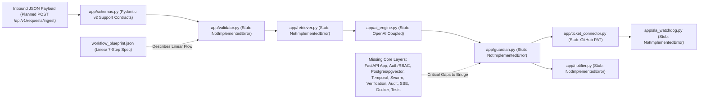
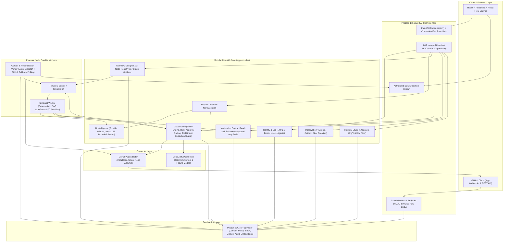
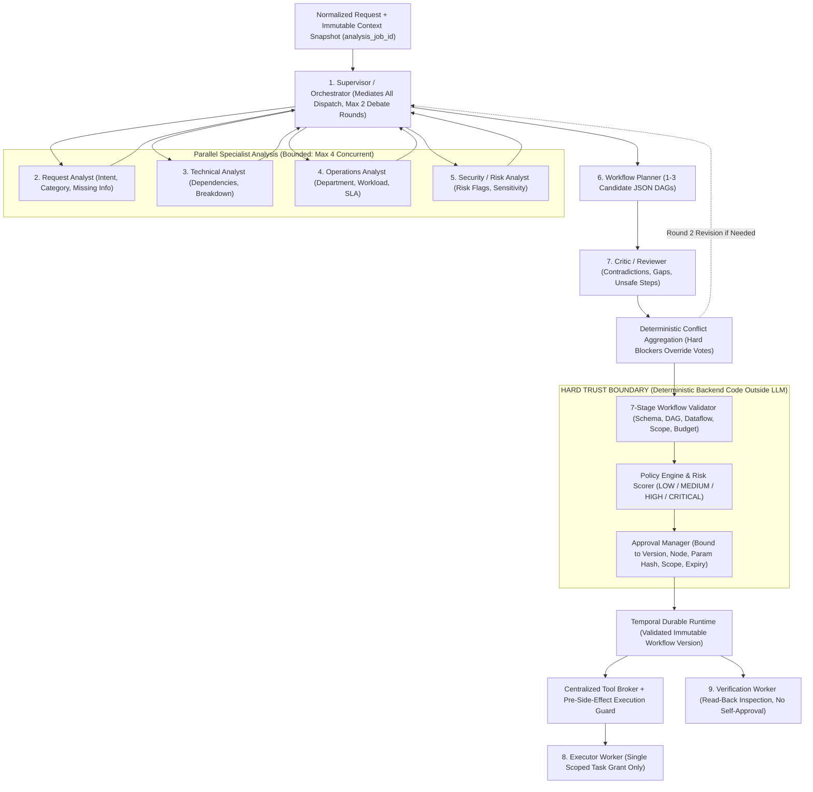
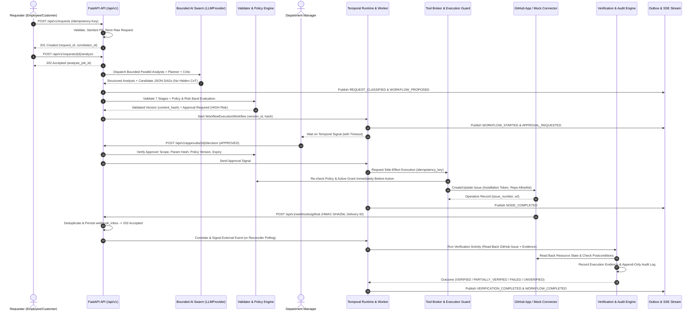
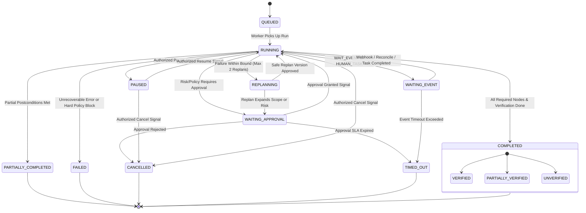
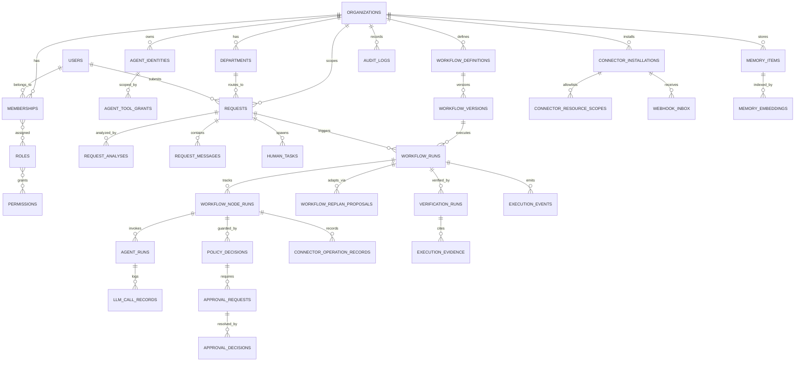

# KẾ HOẠCH TRIỂN KHAI HOÀN CHỈNH BACKEND — VADIRAS FLOW

> [!IMPORTANT]
> Tài liệu này được tổng hợp trực tiếp từ 2 tài liệu đặc tả trong thư mục `docs/` ([Vadiras_Flow_Backend_Technical_Spec_v1.md](file:///c:/GitHub/VADIRAS-FLOW/docs/Vadiras_Flow_Backend_Technical_Spec_v1.md) và [Antigravity_Master_Prompt_Vadiras_Flow_BE.md](file:///c:/GitHub/VADIRAS-FLOW/docs/Antigravity_Master_Prompt_Vadiras_Flow_BE.md)) kết hợp với kết quả kiểm toán thực tế toàn bộ mã nguồn hiện có của repository `c:\GitHub\VADIRAS-FLOW`.
> **Không có bất kỳ file mã nguồn nào (`app/`, `requirements.txt`, `.env.example`, `workflow_blueprint.json`) bị chỉnh sửa trong bước lập kế hoạch này.**

---

## 1. Tổng quan & Nguyên tắc Kiến trúc Cốt lõi

**Vadiras Flow** là nền tảng điều phối quy trình doanh nghiệp (enterprise workflow orchestration) có hỗ trợ AI. Hệ thống tiếp nhận yêu cầu nội bộ và khách hàng, chuẩn hóa và phân loại, điều phối đội ngũ AI agent chuyên biệt có giới hạn (bounded swarm) để đề xuất workflow, kiểm soát quyền hạn & rủi ro qua Policy Engine độc lập, thực thi bền vững bằng Temporal, xác minh kết quả bằng bằng chứng đọc ngược (read-back evidence), và lưu trữ nhật ký kiểm toán cùng bộ nhớ tái sử dụng.

### Nguyên tắc Sản phẩm & Ranh giới Tin cậy (Non-Negotiable Trust Boundaries)

- **Chu trình sản phẩm:** *Think to understand -> Design to plan -> Control to authorize -> Act to execute -> Verify to prove -> Learn to improve*.
- **Nguyên tắc kiến trúc bất di bất dịch:** **LLM proposes; Policy Engine authorizes; Temporal/runtime executes; Verification proves.**
- **6 ranh giới bảo mật bắt buộc:**
  1. Mọi đầu ra từ LLM đều là dữ liệu không đáng tin cậy (untrusted input) — phải kiểm tra theo Pydantic schema nghiêm ngặt và ủy quyền độc lập ở backend.
  2. Tuyệt đối **không** thực thi mã nguồn do LLM sinh ra (`eval`, sinh code Python, lệnh shell, dynamic import). Workflow chỉ chạy JSON DSL khai báo trên tập node đã đăng ký.
  3. Không agent nào được tự cấp quyền, sửa policy, tạo credential, tự phê duyệt tác vụ của mình hoặc đi vòng qua Policy Engine / Tool Broker.
  4. Code Temporal Workflow phải **thuần xác định (deterministic)**; toàn bộ I/O (DB, HTTP, GitHub, LLM) bắt buộc nằm trong Activities.
  5. Phản hồi HTTP `2xx` hoặc agent báo `success=true` **không** đồng nghĩa nghiệp vụ đã hoàn tất — bắt buộc có bước kiểm chứng bằng chứng (Verification + Read-back).
  6. Mọi dữ liệu nghiệp vụ/sự kiện/bộ nhớ đều gắn `organization_id`; tài khoản khách hàng (`CUSTOMER_CONTACT`) tuyệt đối không thấy ghi chú nội bộ hoặc yêu cầu của khách hàng khác.

### Cấu hình Đã Chốt & Phạm vi Demo

| Hạng mục | Lựa chọn đã chốt | Diễn giải triển khai |
|---|---|---|
| Tổ chức & Phòng ban | 1 Organization, 6 Departments | `Support`, `Engineering`, `DevOps`, `Security`, `Product`, `Management` (luôn gắn `organization_id` để sẵn sàng mở rộng multi-tenant) |
| Đối tượng gửi yêu cầu | Internal & External | `EMPLOYEE` (nhân viên nội bộ) và `CUSTOMER_CONTACT` (liên hệ khách hàng, cô lập quyền xem nghiêm ngặt) |
| 5 nhóm yêu cầu demo | Extensible `request_type` | `INCIDENT`, `CHANGE`, `SERVICE_REQUEST`, `ONBOARDING`, `INTERNAL_TASK` |
| Backend & DB | Python 3.11 + FastAPI + PostgreSQL + pgvector | SQLAlchemy 2.x async, Alembic migrations, Pydantic v2, JSONB cho graph/config mở rộng |
| Workflow Runtime | Temporal Python SDK | Điều phối DAG bền vững, timer, signal/update, pause/resume/cancel, retry, idempotency |
| AI & Agent Topology | Provider-agnostic + Bounded Swarm (9 vai trò) | `LLMProvider` protocol + `MockLLMProvider` mặc định; real provider chỉ nạp qua biến môi trường; Supervisor điều phối song song có giới hạn |
| Tích hợp ngoài | GitHub App + `MockGitHubConnector` | Token theo installation (least privilege: Metadata Read, Issues R/W), webhook HMAC-SHA256 + `webhook_inbox` + polling reconciliation |
| Xác thực & Phê duyệt | JWT + Argon2id, RBAC + ABAC, Risk-based Approval | Policy Engine tách biệt khỏi AI; kiểm tra quyền trước mọi side-effect (Execution Guard) |
| Realtime & Frontend | REST `/api/v1` + SSE + React Flow schema | Backend là nguồn chân lý duy nhất cho schema node, validation, quyền hạn và trạng thái chạy |
| Hạ tầng local | Docker Compose | `postgres` (pgvector), `temporal`, `temporal-ui`, `api`, `temporal-worker`, `outbox-worker`. **Không** thêm Redis, Kafka, Kubernetes |

### Phạm vi Trong Demo vs. Ngoài Phạm vi (Deferred)

- **Trong phạm vi (In-Scope):** 1 tổ chức / 6 phòng ban, 5 loại yêu cầu, bounded swarm phân tích & lập kế hoạch, DSL validation & versioning bất biến, Temporal durable runtime, risk-based approval, GitHub App (Issues R/W) + Mock connector + Webhook + Reconciliation, Verification dựa trên bằng chứng, Audit append-only, Analytics 7 nhóm chỉ số, pgvector memory advisory có lọc quyền, SSE, Docker Compose + bộ test tự động.
- **Ngoài phạm vi demo ban đầu (Out-of-Scope / DEFER):** Tự động deploy production hoặc sửa hạ tầng thật; thực thi code LLM sinh; mạng agent ngang hàng không kiểm soát; bộ connector ERP/CRM/Jira/Slack/Email đầy đủ; Production SSO/SAML federation; Multi-tenant SaaS billing; AI tự sửa policy hoặc tự fine-tune model; dự báo phân tích chuyên sâu cho mọi ngành.

---

## 2. Phase 0 — Kiểm toán Repository Hiện tại (Architecture Inventory & Mapping)

### 2.1 Kiểm kê Thực tế Mã nguồn & Môi trường

- **Lịch sử Git:** 2 commit (`1586a71 Initial commit`, `7d03009 Bootstrap data contracts and workflow blueprint`). Thư mục `docs/` hiện đang untracked; không có chỉnh sửa dở dang trên các file đã track.
- **Môi trường local đã xác minh:**
  - Python `3.11.9`
  - Quản lý gói: `pip` + [requirements.txt](file:///c:/GitHub/VADIRAS-FLOW/requirements.txt) (không cài sẵn `uv` hoặc `poetry` — giữ chuẩn `requirements.txt` và bổ sung ràng buộc phiên bản ổn định).
  - Test runner: `pytest 8.4.2` đã cài, hiện có **0 bài test** (`tests/` chỉ chứa `.gitkeep`).
  - Container runtime: `Docker 28.5.1` và `Docker Compose v2.40.3` sẵn sàng (chưa có `Dockerfile` và `docker-compose.yml`).
- **Tồn kho file hiện có trong repo:**
  - [app/schemas.py](file:///c:/GitHub/VADIRAS-FLOW/app/schemas.py) (283 dòng): Định nghĩa tốt nền tảng Pydantic v2 (`ContractModel` với `extra="forbid"`, `str_strip_whitespace=True`), nhưng mô hình hóa theo hướng support-ticket đơn lẻ (`InboundRequest`, `CustomerInfo`, `ProductInfo`, `RequestCategory` gồm 7 giá trị như `bug_backend`, `billing_refund`; `RecommendedTeam` cứng 7 team; `WorkflowTemplate` cứng 6 template; có trường `reasoning_trace`).
  - 7 module stub trong `app/` đều chỉ khai báo chữ ký hàm đồng bộ (sync) và ném `NotImplementedError`: [validator.py](file:///c:/GitHub/VADIRAS-FLOW/app/validator.py), [retriever.py](file:///c:/GitHub/VADIRAS-FLOW/app/retriever.py), [ai_engine.py](file:///c:/GitHub/VADIRAS-FLOW/app/ai_engine.py), [guardian.py](file:///c:/GitHub/VADIRAS-FLOW/app/guardian.py), [ticket_connector.py](file:///c:/GitHub/VADIRAS-FLOW/app/ticket_connector.py), [notifier.py](file:///c:/GitHub/VADIRAS-FLOW/app/notifier.py), [sla_watchdog.py](file:///c:/GitHub/VADIRAS-FLOW/app/sla_watchdog.py).
  - [workflow_blueprint.json](file:///c:/GitHub/VADIRAS-FLOW/workflow_blueprint.json): Bản phác thảo 7 bước tuyến tính cho `"FastAPI Deterministic State Machine"` với trigger `POST /api/v1/requests/ingest`.
  - [requirements.txt](file:///c:/GitHub/VADIRAS-FLOW/requirements.txt): 10 gói chưa pin version (`fastapi`, `uvicorn[standard]`, `pydantic>=2.0`, `pydantic-settings`, `python-dotenv`, `openai`, `httpx`, `rank-bm25`, `pytest`, `pytest-asyncio`).
  - [.env.example](file:///c:/GitHub/VADIRAS-FLOW/.env.example): Cấu hình SQLite (`DATABASE_PATH=vadiraflow.db`), `OPENAI_API_KEY`, `OPENAI_MODEL=gpt-4o-mini`, `GITHUB_TOKEN` (PAT), `GITHUB_REPO`, `NOTIFICATION_WEBHOOK_URL`, `DEMO_MODE=true`.
  - Các thư mục trống (chỉ có `.gitkeep`): `data/`, `prompts/`, `scripts/`, `tests/`, `frontend/`.

### 2.2 Xung đột Kiến trúc Giữa Repo Bootstrap và Spec v1.0 & Quyết định Xử lý

| # | Xung đột / Khoảng trống | Thực trạng Repo Bootstrap | Yêu cầu Spec v1.0 | Quyết định chuyển đổi an toàn |
|---|---|---|---|---|
| 1 | Cơ sở dữ liệu & Vector | `.env.example` dùng SQLite (`vadiraflow.db`), chưa có ORM/Migration | PostgreSQL 16 + `pgvector`, SQLAlchemy 2.x async, Alembic | Chuyển sang `DATABASE_URL` (PostgreSQL + `asyncpg` + `pgvector`) qua Docker Compose; tạo bộ Alembic migration sạch từ đầu |
| 2 | Workflow Engine | `workflow_blueprint.json` mô tả state machine tuyến tính 7 bước trong FastAPI | Temporal Python SDK thực thi JSON DAG có phiên bản (12 node type) | Giữ `workflow_blueprint.json` làm tài liệu tham chiếu v0; triển khai JSON DAG DSL + Temporal Workflows/Activities bền vững |
| 3 | AI Provider & Topology | `requirements.txt` buộc vào `openai`; `ai_engine.py` sync 1 bước; `schemas.py` có `reasoning_trace` | Vendor-neutral `LLMProvider` + `MockLLMProvider`; Bounded Swarm 9 vai trò; **cấm** lưu hidden CoT | Xây dựng `LLMProvider` protocol + `MockLLMProvider` + adapter HTTP cấu hình qua env; thay `reasoning_trace` bằng `decision_summary`, `assumptions`, `evidence_refs` |
| 4 | Tích hợp GitHub | `.env.example` dùng PAT (`GITHUB_TOKEN`); `ticket_connector.py` chỉ có `create_ticket()` | GitHub App (installation token ngắn hạn, repo allowlist, HMAC-SHA256 webhook, inbox, reconciler) + `MockGitHubConnector` | Thay PAT bằng GitHub App connector chuẩn + `MockGitHubConnector` hỗ trợ giả lập lỗi/trùng webhook/trễ trạng thái |
| 5 | Domain Contracts | `app/schemas.py` hướng support-ticket, thiếu `organization_id`, thiếu phân biệt Employee/Customer | Core doanh nghiệp tổng quát: 1 Org, 6 Dept, 5 Request Category, cô lập dữ liệu khách hàng | Kế thừa `ContractModel` (strict Pydantic v2); tổ chức schema mới trong `app/modules/*/schemas.py` và giữ adapter tương thích ngược cho `schemas.py` nếu cần |
| 6 | Auth, Governance, Verification, Observability, Memory | Hoàn toàn chưa có (chỉ có stub `guardian.py`) | JWT + Argon2id, RBAC+ABAC, Policy Engine, Approval Binding, Execution Guard, Read-back Verification, Outbox/SSE, Analytics, pgvector | Bổ sung đầy đủ theo kiến trúc Modular Monolith dưới `app/modules/` và `app/core/` |

### 2.3 Bảng Ánh xạ Yêu cầu -> Mã nguồn (Requirement-to-Code Mapping)

| Thành phần / Yêu cầu Spec | Hiện trạng trong Repo | Nhãn | Hướng xử lý cụ thể |
|---|---|---|---|
| `ContractModel`, `RiskLevel`, `ApprovalStatus`, `AttachmentMeta`, `WorkflowMetrics` | [app/schemas.py](file:///c:/GitHub/VADIRAS-FLOW/app/schemas.py) | `EXTEND` | Kế thừa cấu hình strict Pydantic v2 vào `app/core/schemas.py`; tách domain schemas theo từng module; giữ compatibility shim |
| `InboundRequest`, `AIAnalysisOutput`, `GuardianDecision`, `WorkflowStatus` | [app/schemas.py](file:///c:/GitHub/VADIRAS-FLOW/app/schemas.py) | `REFACTOR` | Bổ sung `organization_id`, `requester_kind`, 5 `request_type` mở rộng, bỏ `reasoning_trace`, bổ sung trạng thái Temporal & Verification |
| Request validation, PII redaction, idempotency hash | [app/validator.py](file:///c:/GitHub/VADIRAS-FLOW/app/validator.py) | `EXTEND` | Hiện thực hóa trong `app/modules/requests/intake.py` + bổ sung 7-stage Workflow Graph Validator tại `app/modules/workflows/validator.py` |
| Context & Knowledge retrieval (`rank-bm25`) | [app/retriever.py](file:///c:/GitHub/VADIRAS-FLOW/app/retriever.py) | `REFACTOR` | Thay stub BM25 bằng `app/modules/memory/` dùng PostgreSQL + `pgvector` với bộ lọc org/department/visibility bắt buộc |
| AI classification & reasoning | [app/ai_engine.py](file:///c:/GitHub/VADIRAS-FLOW/app/ai_engine.py) | `REFACTOR` | Tiến hóa thành `app/modules/ai_intelligence/`: `LLMProvider`, `MockLLMProvider`, Prompt Registry và Bounded 9-Role Swarm |
| Safety policy & approval control | [app/guardian.py](file:///c:/GitHub/VADIRAS-FLOW/app/guardian.py) | `REFACTOR` | Tiến hóa thành `app/modules/governance/`: RBAC/ABAC, Policy Engine, Risk Scorer, Approval Binding, Tool Broker, Execution Guard |
| External ticket creation | [app/ticket_connector.py](file:///c:/GitHub/VADIRAS-FLOW/app/ticket_connector.py) | `REFACTOR` | Tiến hóa thành `app/modules/connectors/`: `BaseConnector`, `GitHubAppConnector`, `MockGitHubConnector`, Webhook Inbox, Reconciler |
| Notifications | [app/notifier.py](file:///c:/GitHub/VADIRAS-FLOW/app/notifier.py) | `EXTEND` | Tiến hóa thành `NOTIFICATION` node executor + Outbox/SSE broadcaster trong `app/modules/observability/` |
| SLA monitoring | [app/sla_watchdog.py](file:///c:/GitHub/VADIRAS-FLOW/app/sla_watchdog.py) | `EXTEND` | Hiện thực hóa trong `app/modules/observability/sla.py` tích hợp Temporal timers và bảng `sla_policies` |
| Workflow blueprint v0 | [workflow_blueprint.json](file:///c:/GitHub/VADIRAS-FLOW/workflow_blueprint.json) | `REFACTOR` | Giữ nguyên file gốc làm tham chiếu; tạo 5 template JSON DAG chuẩn trong `data/workflow_templates/` |
| FastAPI App, Config, Structured Logging, Error Envelope | Chưa có | `ADD` | Tạo `app/main.py`, `app/core/{config,logging,errors,correlation,security}.py` |
| SQLAlchemy 2 Async DB + Alembic Migrations | Chưa có | `ADD` | Tạo `app/db/`, `alembic/`, 7 revision migration có version |
| Identity, Org, 6 Departments, RBAC/ABAC, Agent Principals | Chưa có | `ADD` | Tạo `app/modules/identity/` và `app/modules/agents/` |
| Workflow Designer, 12-Node Registry, Versioning, Scoring | Chưa có | `ADD` | Tạo `app/modules/workflows/` |
| Temporal Runtime (Workflows, Activities, Worker, Signals) | Chưa có | `ADD` | Tạo `app/modules/runtime/` |
| Verification Engine, Read-back Evidence, Append-only Audit | Chưa có | `ADD` | Tạo `app/modules/verification/` |
| Transactional Outbox, SSE Stream, 7 Analytics Endpoints | Chưa có | `ADD` | Tạo `app/modules/observability/` |
| Docker Compose, Seed Scripts, Unit/Integration/E2E Tests | Chưa có | `ADD` | Tạo `Dockerfile`, `docker-compose.yml`, `scripts/seed_demo.py`, `tests/` |
| Production SSO/SAML, Multi-tenant SaaS Billing, ERP/Jira/Slack, Auto-deploy Prod, Full DB RLS | Ngoài phạm vi demo | `DEFER` | Ghi nhận rõ trong kiến trúc mở rộng; không cài đặt trong bản prototype |

---

## 3. Hệ thống Sơ đồ Kiến trúc (Diagram Map Suite)

### 3.1 Diagram 1 — Kiến trúc Hiện tại (As-Is Bootstrap)



### 3.2 Diagram 2 — Kiến trúc Mục tiêu (To-Be Modular Monolith & Runtime Processes)



### 3.3 Diagram 3 — Topology Bounded Multi-Agent Swarm & Ranh giới Tin cậy (Trust Boundaries)



### 3.4 Diagram 4 — Luồng Xử lý End-to-End (Golden Path Lifecycle)



### 3.5 Diagram 5 — Máy trạng thái Workflow Run & Kết quả Verification



### 3.6 Diagram 6 — Sơ đồ Quan hệ Dữ liệu Cốt lõi (PostgreSQL + pgvector ERD)



### 3.7 Diagram 7 — Lộ trình Triển khai 11 Phase & Đường găng Vertical Slice

```mermaid
flowchart LR
    P0["Phase 0-1: Audit & Plan (DONE)"]
    P2["Phase 2: Foundation, DB, Alembic, Auth & Org Scope"]
    P3["Phase 3: Request Domain, 6 Depts & Seed Data"]
    P4["Phase 4: LLM Provider, MockLLM & Bounded Swarm"]
    P5["Phase 5: Workflow DSL, 12-Node Registry & Validator"]
    P6["Phase 6: Governance, Policy Engine, Risk & Approvals"]
    P7["Phase 7: Temporal Runtime, Signals & Idempotency"]
    P8["Phase 8: GitHub App, Mock Connector, Webhook & Reconcile"]
    P9["Phase 9: Verification, Read-Back Evidence & Audit"]
    MVP["MVP VERTICAL SLICE GATE (Incident + Change E2E Verified)"]
    P10["Phase 10: pgvector Memory, 7 Analytics APIs & SSE"]
    P11["Phase 11: Docker Compose Hardening, 10 E2E Tests & Runbook"]

    P0 --> P2
    P2 --> P3
    P3 --> P4
    P3 --> P5
    P4 --> P5
    P2 --> P6
    P5 --> P6
    P6 --> P7
    P7 --> P8
    P8 --> P9
    P9 --> MVP
    MVP --> P10
    P10 --> P11
```



---

## 4. Cấu trúc Thư mục & Modular Monolith Đề xuất

Giữ nguyên thư mục gốc `app/` và cấu trúc `data/`, `prompts/`, `scripts/`, `tests/`, `docs/` của repository hiện có, tổ chức theo mô hình **Modular Monolith** gồm 11 module nghiệp vụ độc lập:

```text
c:\GitHub\VADIRAS-FLOW\
├── alembic/
│   ├── env.py
│   └── versions/
│       ├── 0001_enable_pgvector_and_identity.py
│       ├── 0002_request_domain.py
│       ├── 0003_workflow_and_runtime.py
│       ├── 0004_ai_and_agent_execution.py
│       ├── 0005_governance_and_approvals.py
│       ├── 0006_connectors_inbox_outbox_audit.py
│       └── 0007_memory_sla_and_analytics.py
├── alembic.ini
├── app/
│   ├── __init__.py
│   ├── main.py                         # FastAPI app factory, lifespan, CORS, middleware, /health
│   ├── schemas.py                      # Legacy compatibility shim (re-export / adapter giữ tương thích)
│   ├── core/
│   │   ├── config.py                   # Pydantic Settings (không hard-code vendor hay secret)
│   │   ├── logging.py                  # Structlog JSON + redaction filter + correlation fields
│   │   ├── security.py                 # Argon2id hashing, JWT sign/verify, constant-time HMAC
│   │   ├── errors.py                   # Error envelope chuẩn & mã lỗi ổn định
│   │   ├── correlation.py              # X-Correlation-ID & Idempotency-Key context
│   │   └── schemas.py                  # ContractModel base, Pagination, Envelope schemas
│   ├── db/
│   │   ├── base.py                     # SQLAlchemy 2 DeclarativeBase
│   │   ├── mixins.py                   # UUIDMixin, OrgScopedMixin, TimestampMixin
│   │   └── session.py                  # AsyncEngine, async_sessionmaker, get_db dependency
│   ├── modules/
│   │   ├── identity/                   # Org, Users, Memberships, 6 Depts, Roles, Permissions, Auth routes
│   │   ├── requests/                   # Requests, Participants, Messages, Attachments, Intake/PII, HumanTasks
│   │   ├── ai_intelligence/
│   │   │   ├── providers/              # base.py (LLMProvider), mock_provider.py, openai_compat.py, registry.py
│   │   │   ├── swarm/                  # supervisor.py, specialists.py, planner.py, critic.py, aggregator.py
│   │   │   └── prompts/                # Loader có version cho prompts/
│   │   ├── workflows/                  # dsl/ (12 node schemas + safe expr), registry.py, validator.py, scoring.py, service.py, router.py
│   │   ├── agents/                     # Agent principals, capabilities, tool_grants, task/run repository
│   │   ├── governance/                 # rbac.py, policy_engine.py, risk.py, approvals.py, tool_broker.py, execution_guard.py
│   │   ├── runtime/                    # temporal_client.py, workflows.py (deterministic), activities.py (I/O), worker.py, state_machine.py
│   │   ├── connectors/                 # base.py, github_app.py, mock_github.py, webhook_inbox.py, reconciler.py, router.py
│   │   ├── verification/               # engine.py, postconditions.py, evidence.py, audit.py, router.py
│   │   ├── observability/              # events.py, outbox.py, outbox_worker.py, sse.py, sla.py, analytics.py, router.py
│   │   └── memory/                     # embeddings.py, repository.py, retrieval.py (org+visibility filtered), router.py
│   └── legacy_stubs/                   # Lưu vết tham chiếu nếu cần chuyển tiếp từ 7 file stub gốc
├── data/
│   ├── seeds/                          # Demo org, 6 depts, users, roles, agents, policies, SLA
│   └── workflow_templates/             # 5 JSON DAG templates (Incident, Change, Service, Onboarding, Internal)
├── docs/
│   ├── Antigravity_Master_Prompt_Vadiras_Flow_BE.md
│   ├── Vadiras_Flow_Backend_Technical_Spec_v1.md
│   ├── BACKEND_IMPLEMENTATION_PLAN.md  # File kế hoạch này
│   └── DEMO_RUNBOOK.md                 # Tạo ở Phase 11
├── prompts/                            # Versioned system prompts & JSON schemas theo từng agent role
├── scripts/
│   ├── seed_demo.py                    # Idempotent demo seed script
│   └── run_reconciler.py               # Manual/cron reconciliation helper
├── tests/
│   ├── conftest.py                     # Async test DB, MockLLM, MockGitHub, auth fixtures
│   ├── unit/                           # Schema, DSL validator, policy, risk, swarm, idempotency, memory filter
│   ├── integration/                    # Alembic clean apply, RBAC, Temporal mock activities, webhook HMAC, outbox
│   ├── security/                       # Customer isolation, prompt injection, privilege escalation, stale JWT
│   └── e2e/                            # 10 kịch bản nghiệm thu End-to-End
├── Dockerfile
├── docker-compose.yml
├── requirements.txt
├── .env.example
└── workflow_blueprint.json             # Giữ nguyên làm tham chiếu v0
```

### Quy tắc Phụ thuộc Giữa Các Tầng (Enforced Architecture Rules)

1. **Domain services không được import `fastapi` hoặc module `router.py`.**
2. **AI Intelligence không được ghi trực tiếp vào bảng domain hoặc gọi trực tiếp connector ngoài** — chỉ trả về cấu trúc Pydantic cho lớp orchestrator/runtime.
3. **Mọi lệnh gọi connector bắt buộc đi qua `ToolBroker` -> `ExecutionGuard` -> `PolicyEngine`.**
4. **Code trong `app/modules/runtime/workflows.py` phải tuyệt đối xác định:** cấm gọi `datetime.now()`, `uuid4()`, DB session, `httpx`, hay `LLMProvider` trực tiếp; phải dùng `workflow.now()`, `workflow.uuid4()` và đẩy toàn bộ I/O sang `activities.py`.

---

## 5. Thiết kế Mô hình Dữ liệu & Kế hoạch Migration (Alembic)

### 5.1 Quy ước Chung & Cô lập Dữ liệu

- Mọi bảng nghiệp vụ đều có: `id` (`UUID` PK), `organization_id` (`UUID` FK -> `organizations.id`, có index), `created_at`, `updated_at` (`TIMESTAMPTZ` UTC), `created_by` / `updated_by` khi phù hợp.
- **Immutability:** `workflow_versions` ở trạng thái `PUBLISHED` không thể sửa nội dung `graph_json` hay `content_hash` (SHA-256 chuẩn hóa). Mỗi `workflow_runs` ghim chặt `workflow_version_id` và `workflow_content_hash`.
- **Append-only:** `audit_logs`, `execution_events`, `execution_evidence` chỉ hỗ trợ `INSERT` ở tầng repository (không có hàm `UPDATE`/`DELETE`).
- **Organization & Customer Isolation:** Mọi truy vấn repository bắt buộc nhận `ActorContext(organization_id, user_id, actor_kind, department_ids, permissions)` và áp bộ lọc `organization_id` + `visibility` (`CUSTOMER_VISIBLE` vs `INTERNAL_ONLY`).

### 5.2 Danh mục ~35 Bảng Theo 8 Nhóm Nghiệp vụ & Chuỗi Alembic Migration

| Revision Alembic | Nhóm thực thể | Danh sách bảng & trường/index trọng yếu |
|---|---|---|
| `0001_enable_pgvector_and_identity` | Extension & Identity/Org | `CREATE EXTENSION vector`; `organizations`, `users` (`password_hash` Argon2id), `memberships` (`user_kind`: `EMPLOYEE` / `CUSTOMER_CONTACT`, `status`), `departments` (6 phòng ban), `roles`, `permissions`, `role_permissions`, `membership_roles`, `refresh_tokens` (rotation/revocation) |
| `0002_request_domain` | Request Domain | `requests` (`request_number`, `request_type`, `status`, `business_outcome`, `priority`, `impact`, `urgency`, `requester_id`, `requester_kind`, `customer_account_ref`, `department_id`, `idempotency_key`, `due_at`, `metadata` JSONB), `request_participants`, `request_attachments`, `request_messages` (`visibility`: `INTERNAL_ONLY` / `CUSTOMER_VISIBLE`), `request_analyses` (versioned output + `provider`, `model`, `prompt_version`), `human_tasks` (`status`, `assignee_id`, `department_id`, `evidence_json`) |
| `0003_workflow_and_runtime` | Workflow & Temporal State | `workflow_definitions` (`domain_pack`, `request_type`), `workflow_versions` (`version_number`, `status`, `graph_json` JSONB, `content_hash`, `validation_report` JSONB, `published_at`), `workflow_runs` (`temporal_workflow_id`, `temporal_run_id`, `status`, `workflow_version_id`, `content_hash`, `replan_count`, `idempotency_key`), `workflow_node_runs` (`node_id`, `node_type`, `status`, `attempt`, `input_summary`, `output_summary`, `error_class`), `workflow_replan_proposals` (`parent_version_id`, `proposed_version_id`, `reason`, `scope_delta`, `status`) |
| `0004_ai_and_agent_execution` | AI Swarm & Agents | `agent_identities` (`role_code`, `status`, `owner_id`, `limits_json`), `agent_capabilities`, `agent_tool_grants` (`capability`, `resource_scope`, `expires_at`), `agent_tasks`, `agent_runs` (`analysis_job_id`, `round_number`, `structured_output` JSONB, `decision_summary`, `assumptions`, `evidence_refs`, `confidence`), `llm_call_records` (`provider`, `model`, `purpose`, `latency_ms`, `prompt_tokens`, `completion_tokens`, `cost_usd`, `cost_source`: `ACTUAL`/`ESTIMATED`/`UNKNOWN`), `prompt_versions` |
| `0005_governance_and_approvals` | Governance & Approval | `policy_sets` (`version`, `is_active`), `policy_rules` (`action`, `risk_band`, `conditions_json`, `effect`), `policy_decisions` (`actor_type`, `actor_id`, `action`, `resource_scope`, `risk_level`, `decision`, `policy_version`, `triggered_rules`), `approval_requests` (`workflow_run_id`, `workflow_version_id`, `node_id`, `action`, `parameter_hash`, `resource_scope`, `policy_version`, `risk_level`, `status`, `expires_at`), `approval_decisions` (`approver_id`, `decision`, `rationale`, `authority_checked`), `permission_grants` (narrow, short-lived task grants) |
| `0006_connectors_inbox_outbox_audit` | Connectors, Events & Audit | `connector_installations` (`provider`, `installation_id`, `status`, `config_json`), `connector_resource_scopes` (repo allowlist), `connector_secret_references` (reference only, no plaintext secrets), `webhook_inbox` (unique `provider` + `delivery_id`, `signature_valid`, `processed_at`), `integration_sync_cursors`, `connector_operation_records` (unique `organization_id` + `idempotency_key`, `external_id`, `external_url`, `status`), `outbox_events` (`event_type`, `payload_json`, `published_at`, `retry_count`), `execution_events`, `verification_runs` (`outcome`: `VERIFIED`/`PARTIALLY_VERIFIED`/`FAILED`/`UNVERIFIED`), `execution_evidence` (`source_type`, `source_ref`, `content_hash`, `fresh_until`, `visibility`), `audit_logs` (append-only) |
| `0007_memory_sla_and_analytics` | Memory, SLA & Cost | `knowledge_sources`, `memory_items` (`memory_class` 5 loại, `department_id`, `visibility`, `request_type`, `status`, `valid_until`, `promoted_by_verification_id`), `memory_embeddings` (`embedding` `vector(1536)` hoặc cấu hình động theo model, `embedding_model`, `dimensions`), `sla_policies`, `cost_records` (`cost_source`), `metric_snapshots` (optional materialized rollups) |

---

## 6. Kế hoạch API Contract & OpenAPI (`/api/v1`)

### 6.1 Quy chuẩn API Chung

- **Error Envelope thống nhất:** `{"error": {"code": "POLICY_DENIED", "message": "...", "details": [...], "correlation_id": "..."}}`.
- **Headers:** Mọi response trả về `X-Correlation-ID`; các endpoint tạo request và khởi chạy/thực thi hành động có side-effect hỗ trợ/bắt buộc `Idempotency-Key`.
- **Async Semantics:** Endpoint kích hoạt phân tích swarm hoặc chạy workflow trả về `202 Accepted` kèm resource ID và URL trạng thái.
- **Pagination & Filter:** `limit` (mặc định 20, tối đa 100), `offset` / cursor, `sort_by`, `sort_dir`.
- **Serialization Boundary:** `CustomerRequestResponse` loại bỏ hoàn toàn ghi chú nội bộ (`INTERNAL_ONLY`), phân tích rủi ro nội bộ, audit chi tiết và `workflow_node_runs` nội bộ.

### 6.2 Danh mục Endpoint Đầy đủ (49 Endpoints)

| Nhóm | Method & Path | Mô tả & Quyền hạn chính |
|---|---|---|
| **Health** | `GET /health/live`, `GET /health/ready` | Kiểm tra API, PostgreSQL và kết nối Temporal |
| **Auth & Identity** | `POST /api/v1/auth/login`, `POST /api/v1/auth/refresh`, `POST /api/v1/auth/logout`, `GET /api/v1/auth/me` | JWT ngắn hạn + refresh rotation/revocation; tải quyền hiện hành từ DB cho mọi hành động đặc quyền |
| **Org & Users** | `GET /api/v1/departments`, `GET /api/v1/users` | Danh sách 6 phòng ban; danh sách người dùng giới hạn cho Admin/Manager |
| **Requests & AI** | `POST /api/v1/requests`, `GET /api/v1/requests`, `GET /api/v1/requests/{id}`, `PATCH /api/v1/requests/{id}` | Tạo/xem/cập nhật request; phân tách chế độ xem Employee vs Customer Contact |
| **Intelligence** | `POST /api/v1/requests/{id}/analyze`, `GET /api/v1/requests/{id}/analysis`, `POST /api/v1/requests/{id}/clarifications`, `POST /api/v1/requests/{id}/propose-workflows` | Chạy Bounded Swarm (`202`), xem kết quả phân tích có version, trả lời làm rõ, đề xuất 1–3 candidate workflow |
| **Workflow Design** | `GET /api/v1/workflows/node-registry`, `POST /api/v1/workflows`, `GET /api/v1/workflows`, `GET /api/v1/workflows/{id}`, `POST /api/v1/workflows/{id}/versions`, `POST /api/v1/workflows/validate`, `POST /api/v1/workflows/{id}/publish`, `GET /api/v1/workflows/{id}/versions/{vid}` | Cung cấp schema 12 node cho React Flow; kiểm định 7 bước ở server; xuất bản phiên bản bất biến có `content_hash` |
| **Execution & SSE** | `POST /api/v1/workflow-runs`, `GET /api/v1/workflow-runs`, `GET /api/v1/workflow-runs/{run_id}`, `GET /api/v1/workflow-runs/{run_id}/events` (SSE + snapshot), `POST .../pause`, `POST .../resume`, `POST .../cancel`, `POST .../replan` | Điều phối Temporal run; SSE áp đúng RBAC/Org filter; `replan` chỉ tạo `replan_proposal` có giới hạn (không sửa trực tiếp graph đang chạy) |
| **Human Tasks** | `GET /api/v1/tasks`, `GET /api/v1/tasks/{task_id}`, `POST .../claim`, `POST .../complete`, `POST .../block` | Quản lý tác vụ con người; `complete` gửi Temporal signal tiếp tục workflow kèm bằng chứng |
| **Approvals** | `GET /api/v1/approvals`, `GET /api/v1/approvals/{approval_id}`, `POST /api/v1/approvals/{approval_id}/decision` | Hiển thị chính xác action, params hash, scope, risk, version; kiểm tra thẩm quyền người duyệt trước khi mở khóa Temporal signal |
| **Agents & Connectors** | `GET /api/v1/agents`, `GET /api/v1/agents/{agent_id}`, `GET /api/v1/connectors`, `POST /api/v1/connectors/github/installations`, `GET /api/v1/connectors/github/status`, `POST /api/v1/webhooks/github`, `POST /api/v1/connectors/github/reconcile` | Quản lý agent/connector; webhook xác thực HMAC-SHA256 raw body + lưu inbox; admin kích hoạt reconciliation polling |
| **Evidence & Audit** | `GET /api/v1/requests/{id}/verification`, `GET /api/v1/workflow-runs/{run_id}/evidence`, `GET /api/v1/audit-logs` | Kết quả xác minh 4 trạng thái, bằng chứng read-back, nhật ký kiểm toán append-only |
| **Analytics & Memory** | `GET /api/v1/metrics/{overview,sla,automation,cost,agents,departments,industries}`, `GET /api/v1/memory/search` | 7 endpoint thống kê có công thức tường minh; tìm kiếm pgvector lọc cứng theo org/visibility/dept |

---

## 7. Workflow DSL, Node Registry & Bounded Adaptation

### 7.1 12 Loại Node Đăng ký Chính thức (`NodeRegistry`)

Mọi node phải khai báo Pydantic config schema và contract input/output tại `app/modules/workflows/registry.py`. Mọi node type lạ bị từ chối ở bước parse.

| Nhóm | Node Types | Mô tả hành vi & kiểm soát |
|---|---|---|
| Đầu vào & Kết thúc | `TRIGGER`, `END` | Điểm khởi đầu và điểm kết thúc có tiêu chí postcondition |
| AI & Phân tích | `CLASSIFY`, `AI_ANALYSIS`, `AGENT_TASK` | Gọi `LLMProvider` qua Activity; đầu ra bắt buộc khớp Pydantic schema |
| Điều hướng | `CONDITION` | Đánh giá biểu thức khai báo an toàn (AST/JSON operator whitelist: `eq`, `neq`, `in`, `gt`, `lt`, `exists`, `and`, `or`; **tuyệt đối không dùng `eval`**) |
| Con người & Quản trị | `HUMAN_TASK`, `APPROVAL` | Tạo bản ghi DB, chờ Temporal signal với timeout và kiểm tra thẩm quyền |
| Hành động & Sự kiện | `CONNECTOR_ACTION`, `WAIT_EVENT`, `NOTIFICATION` | Side-effect đi qua `ToolBroker` + `ExecutionGuard` + `idempotency_key`; `WAIT_EVENT` tương quan webhook/reconciler |
| Xác minh | `VERIFICATION` | Chạy `VerificationEngine` đọc ngược tài nguyên ngoài và đánh giá bằng chứng |

### 7.2 Đường ống Kiểm định 7 Bước & Chấm điểm Ứng viên

1. **Structural Validation:** Schema đúng, ID duy nhất, cạnh hợp lệ, đồ thị không chu trình (DAG acyclicity), có đường tới `END`.
2. **Dataflow Validation:** Input bắt buộc có sẵn từ trigger hoặc output của node tiền nhiệm tương thích kiểu.
3. **Capability Validation:** Agent/connector capability tồn tại và đang kích hoạt.
4. **Permission Validation:** Actor/agent/connector có đúng scope tài nguyên/hành động.
5. **Policy & Risk Validation:** Gắn cờ phê duyệt hoặc hard-block theo Policy Engine.
6. **Resource Limits Validation:** Số lượng node tối đa, timeout, retry, độ song song (max 4), trần chi phí LLM và rate limit connector.
7. **Verification Validation:** Đảm bảo các hành động trọng yếu có postcondition và nguồn bằng chứng.

- **Công thức xếp hạng ứng viên (chỉ áp dụng sau khi vượt qua toàn bộ Hard Constraints):**
  $$\text{Score} = w_C \cdot \text{Coverage} + w_F \cdot \text{Feasibility} + w_E \cdot \text{Efficiency} - w_R \cdot \text{Risk} - w_K \cdot \text{Cost} - w_T \cdot \text{ExpectedTime}$$
- **Vòng đời Workflow Version:** `DRAFT` -> `VALIDATING` -> `VALID` / `INVALID` -> `AWAITING_APPROVAL` -> `APPROVED` -> `PUBLISHED` (bất biến) -> `ARCHIVED`.
- **Giới hạn Bounded Adaptation (mặc định, cấu hình được):** tối đa **2 lần replan/run**, tối đa **3 lần retry/activity**, tối đa **4 phân tích song song**, timeout hữu hạn cho từng node và toàn run. Replan tạo `workflow_replan_proposals` mới — mọi thay đổi mở rộng quyền, tài nguyên, hành động không thể đảo ngược hoặc tăng mức rủi ro đều buộc tạm dừng và xin phê duyệt mới.

---

## 8. Ma trận Agent Topology, Governance & GitHub App

### 8.1 Ma trận 9 Vai trò Bounded Swarm

| # | Vai trò Agent | Trách nhiệm cốt lõi | Quyền Tool / Dữ liệu | Giới hạn nghiêm cấm |
|---|---|---|---|---|
| 1 | **Supervisor / Orchestrator** | Tạo `analysis_job_id`, điều phối song song tối đa 4 specialist, gom kết quả, giải quyết xung đột (tối đa 2 vòng) | Chỉ giao tiếp qua orchestrator task interface nội bộ | Không thực hiện side-effect ngoài, không bỏ qua blocker bảo mật |
| 2 | **Request Analyst** | Trích xuất intent, `request_type`, thực thể, độ ưu tiên đề xuất, câu hỏi còn thiếu | Đọc ngữ cảnh đã lọc quyền | Không bịa trường thiếu (trả `NEEDS_INFORMATION`) |
| 3 | **Technical Analyst** | Phân tích phụ thuộc kỹ thuật, giả thuyết nguyên nhân, tách nhỏ tác vụ | Đọc GitHub/knowledge khi được phép | Không ghi/sửa repo hoặc tạo ticket trực tiếp |
| 4 | **Operations Analyst** | Định tuyến 6 phòng ban, đánh giá tải công việc và SLA | Đọc metadata phòng ban/SLA | Không tự ý thay đổi chính sách SLA |
| 5 | **Security / Risk Analyst** | Nhận diện dữ liệu nhạy cảm, cờ rủi ro, bề mặt tấn công, cảnh báo phân quyền | Đọc policy metadata | Không sửa policy, không hạ mức rủi ro |
| 6 | **Workflow Planner** | Sinh 1–3 candidate JSON DAG trên 12 node đã đăng ký | Không có tool thực thi | Không sinh code/shell hoặc node chưa đăng ký |
| 7 | **Critic / Reviewer** | Soi mâu thuẫn, lỗ hổng kiểm chứng, bước thiếu an toàn (tối đa 2 vòng) | Chỉ đọc candidate workflow & context | Không tự duyệt hoặc publish workflow |
| 8 | **Executor Worker** | Thực thi 1 hành động connector duy nhất đã được cấp phép | Chỉ 1 `agent_tool_grant` hẹp cho đúng node/run qua Tool Broker | Không kế thừa toàn bộ quyền của requester |
| 9 | **Verification Worker** | Đọc ngược tài nguyên ngoài, đối chiếu postcondition & độ tươi bằng chứng | Chỉ đọc (read-only) qua connector | Không tự phê duyệt (no self-approval) hoặc sửa policy |

### 8.2 Phân tầng Rủi ro, Ràng buộc Phê duyệt & Execution Guard

| Mức rủi ro (`RiskLevel`) | Chính sách xử lý mặc định | Điều kiện thực thi |
|---|---|---|
| `LOW` | Tự động thực thi (`AUTO_EXECUTE`) | Khi vượt qua toàn bộ kiểm tra RBAC/ABAC, policy và ngân sách |
| `MEDIUM` | Xác thực bổ sung / Manager phê duyệt tùy rule | Theo cấu hình `policy_rules` của loại yêu cầu/phòng ban |
| `HIGH` | Bắt buộc phê duyệt tường minh (vd: Change Request) | Dừng tại Temporal signal chờ người có thẩm quyền phê duyệt |
| `CRITICAL` | Chặn mặc định trong demo (`BLOCKED`) | Không tự động chạy; chỉ mở nếu có đường an toàn cấu hình riêng & phê duyệt cấp chỉ định |

- **Ràng buộc Approval (Approval Binding):** Bản ghi `approval_requests` khóa chặt theo 7 yếu tố: `workflow_version_id`, `node_id`, `action`, `parameter_hash` (SHA-256), `resource_scope`, `policy_version`, và `expires_at`. Bất kỳ thay đổi trọng yếu nào đều vô hiệu hóa phê duyệt cũ.
- **Execution Guard:** Chạy ngay trước mỗi lời gọi tool có side-effect (không chỉ lúc khởi tạo workflow) để xác minh lại quyền hiện tại, trạng thái phê duyệt, policy version và `idempotency_key`.

### 8.3 Tích hợp GitHub App (Least-Privilege) & Fallback

- **Quyền tối thiểu GitHub App:** `Repository metadata: Read`, `Issues: Read & Write` (chỉ phục vụ read/create/update/assign/comment). Không xin quyền `Contents`, `Administration`, `Actions`, `Deployments` hay Organization-level.
- **Sự kiện Webhook đăng ký:** `issues` và tùy chọn `issue_comment`.
- **Bảo mật & Độ tin cậy:**
  - Sinh JWT bằng App private key (từ env/secret file ngoài repo) -> đổi lấy Installation Access Token ngắn hạn, cache trong bộ nhớ, làm mới trước khi hết hạn, không bao giờ trả token về frontend/prompt/log.
  - Danh sách repo được phép (`connector_resource_scopes` allowlist).
  - Xác thực `X-Hub-Signature-256` bằng HMAC-SHA256 trên **raw request body** với `hmac.compare_digest`.
  - Chống trùng bằng `X-GitHub-Delivery` lưu vào `webhook_inbox` trước khi trả `202` và xử lý bất đồng bộ.
  - **Reconciliation Polling Fallback:** Dùng cursor theo installation/repo + `last_synced_at` + backoff tôn trọng rate-limit để bắt sự kiện lỡ hoặc chạy demo local không public webhook.
  - **`MockGitHubConnector`:** Hỗ trợ đầy đủ 6 kịch bản cấu hình sẵn cho test/demo: thành công, lỗi tạm thời (transient), lỗi vĩnh viễn, cập nhật trễ, trùng webhook và sai lệch xác minh (verification mismatch).

---

## 9. Kế hoạch Phụ thuộc (Dependencies) & Hạ tầng Docker Compose

### 9.1 Cập nhật `requirements.txt` (Tương thích Python 3.11.9)

| Nhóm | Gói đề xuất | Lý do kỹ thuật |
|---|---|---|
| Web & Contracts | `fastapi>=0.115,<1.0`, `uvicorn[standard]>=0.30`, `pydantic>=2.7,<3.0`, `pydantic-settings>=2.3`, `python-dotenv>=1.0`, `sse-starlette>=2.1` | API bất đồng bộ, strict contract, SSE execution event stream |
| Database & Vector | `sqlalchemy[asyncio]>=2.0.30,<2.1`, `asyncpg>=0.29`, `alembic>=1.13`, `pgvector>=0.3.2` | PostgreSQL async ORM, migration có version, truy vấn vector có lọc quan hệ |
| Workflow Runtime | `temporalio>=1.7,<2.0` | Temporal Python SDK cho durable workflow, activities, signals, timers |
| Auth & Crypto | `pyjwt[crypto]>=2.9`, `pwdlib[argon2]>=0.2.1`, `cryptography>=43.0` | JWT chuẩn (HS256/RS256 cho app & RS256 cho GitHub App JWT), Argon2id password hashing |
| HTTP & Logging | `httpx>=0.27`, `structlog>=24.2` | Gọi GitHub/LLM adapter bất đồng bộ, structured JSON logs kèm redaction |
| Testing | `pytest>=8.3`, `pytest-asyncio>=0.24`, `respx>=0.21` | Unit/Integration/E2E tests và mock HTTP cho GitHub App adapter |

*Lưu ý:* Giữ `rank-bm25` nếu dùng hybrid keyword fallback hoặc gỡ bỏ sạch khi đã thay bằng PostgreSQL full-text + `pgvector`; không hard-code `openai` SDK làm dependency bắt buộc (real provider adapter dùng `httpx` theo chuẩn OpenAI-compatible/generic khi bật biến môi trường).

### 9.2 Hạ tầng Docker Compose Local Demo (6 Services)

Không thêm Redis, Kafka hay Kubernetes. Kiến trúc `docker-compose.yml` gồm:
1. `postgres` (`pgvector/pgvector:pg16`): DB chính + extension `vector`, healthcheck `pg_isready`, volume bền vững.
2. `temporal` (`temporalio/auto-setup`): Temporal server dùng chính PostgreSQL (tách schema/database `temporal`) hoặc SQLite/PG nhẹ cho local demo, có healthcheck.
3. `temporal-ui` (`temporalio/ui`): Giao diện quan sát lịch sử workflow khi demo.
4. `api`: Container chạy `uvicorn app.main:app`, phụ thuộc `postgres` + `temporal` healthy, chạy migration tự động hoặc qua script entrypoint.
5. `temporal-worker`: Chạy `python -m app.modules.runtime.worker` xử lý workflow & activity queues.
6. `outbox-worker`: Chạy `python -m app.modules.observability.outbox_worker` đẩy sự kiện ra SSE và chạy reconciliation fallback định kỳ.

### 9.3 Biến Môi trường Chuẩn (`.env.example` — Chỉ Chứa Placeholder)

- **App & DB:** `APP_ENV`, `APP_HOST`, `APP_PORT`, `CORS_ALLOW_ORIGINS`, `DATABASE_URL` (`postgresql+asyncpg://...`), `LOG_LEVEL`.
- **Auth:** `JWT_SECRET_KEY` (placeholder), `JWT_ISSUER`, `JWT_AUDIENCE`, `JWT_ACCESS_TOKEN_EXPIRE_MINUTES=15`, `JWT_REFRESH_TOKEN_EXPIRE_DAYS=7`.
- **Temporal:** `TEMPORAL_ADDRESS=temporal:7200`, `TEMPORAL_NAMESPACE=default`, `TEMPORAL_TASK_QUEUE=vadiras-flow-main`.
- **AI Provider:** `LLM_PROVIDER=mock`, `LLM_API_BASE_URL=`, `LLM_API_KEY=`, `LLM_MODEL=mock-default`, `SWARM_MAX_CONCURRENT=4`, `SWARM_MAX_ROUNDS=2`, `WORKFLOW_MAX_REPLANS=2`, `ACTIVITY_MAX_RETRIES=3`.
- **GitHub App:** `GITHUB_CONNECTOR_MODE=mock`, `GITHUB_APP_ID=`, `GITHUB_APP_PRIVATE_KEY_PATH=`, `GITHUB_WEBHOOK_SECRET=`, `GITHUB_ALLOWED_REPOS=owner/repo`.

---

## 10. Lộ trình Triển khai Chi tiết Theo Phase (Phase 1 -> Phase 11)

> [!TIP]
> **Chiến lược Vertical Slice (MVP Milestone):** Tập trung hoàn thiện mạch chạy end-to-end thật sự (`Request -> Analyze -> Plan -> Validate -> Approve -> Execute -> Verify -> Audit`) qua **Phase 2 -> Phase 9** cho 2 hành trình trụ cột là **Incident / Bug** và **Change Request** trước khi mở rộng đầy đủ sang Memory, Analytics, SSE và 3 hành trình còn lại ở Phase 10–11.

| Phase | Mục tiêu & Deliverables chính | Kiểm thử & Tiêu chí nghiệm thu (Verification) |
|---|---|---|
| **Phase 1: Architecture & Plan** *(Hoàn tất)* | Kiểm toán repo, ánh xạ yêu cầu, 7 sơ đồ Mermaid, tài liệu kế hoạch này | Người dùng duyệt kế hoạch và 6 quyết định chuyển đổi kiến trúc |
| **Phase 2: Foundation, DB, Auth & Org Scope** | `app/core/*`, `app/db/*`, `app/main.py`, `alembic` rev `0001`, `app/modules/identity/*` (JWT + Argon2id, `/auth/login`, `/refresh`, `/logout`, `/me`, `/departments`, `/users`), `/health/{live,ready}`, `Dockerfile`, `docker-compose.yml` cơ bản | `alembic upgrade head` sạch trên Postgres mới; test unit Argon2id/JWT + integration kiểm tra stale role claim và org scoping |
| **Phase 3: Request Domain & Seed Data** | Migration `0002`, `app/modules/requests/*` (5 `request_type`, PII sanitizer, `Idempotency-Key`, `request_messages` tách `INTERNAL_ONLY`/`CUSTOMER_VISIBLE`, `human_tasks`), `scripts/seed_demo.py` (1 Org, 6 Depts, đủ persona Employee/Customer/Worker/Manager/Security/Admin) | Test integration: tạo đủ 5 loại yêu cầu; **Security test:** `CUSTOMER_CONTACT` không xem được request của khách hàng khác hoặc tin nhắn nội bộ |
| **Phase 4: AI Provider & Bounded Swarm** | Migration `0004`, `app/modules/ai_intelligence/*`: `LLMProvider` protocol, `MockLLMProvider` xác định, `OpenAICompatProvider` (env-driven), Prompt Registry trong `prompts/`, Supervisor + 4 Specialist Analysts song song (max 4) + Critic (max 2 vòng), conflict resolver, `llm_call_records` | Test unit: schema validation, bounded JSON repair, cấm lưu hidden CoT, hard blocker thắng majority vote, `NEEDS_INFORMATION` khi thiếu dữ liệu |
| **Phase 5: Workflow DSL, Registry & Validator** | Migration `0003`, `app/modules/workflows/*`: 12 Node types + `GET /workflows/node-registry`, safe condition evaluator (no `eval`), 7-stage Validator, Candidate Planner & Scorer, Immutable `workflow_versions` (`content_hash`), 5 template JSON trong `data/workflow_templates/` | Test unit: từ chối chu trình (cycle), node lạ, thiếu input mapping, biểu thức nguy hiểm, vượt giới hạn tài nguyên; không cho sửa version đã `PUBLISHED` |
| **Phase 6: Governance, Policy, Risk & Approvals** | Migration `0005`, `app/modules/governance/*`: RBAC+ABAC evaluator, Policy Engine tách biệt AI, Risk Bands (`LOW`/`MEDIUM`/`HIGH`/`CRITICAL`), Approval Binding (7 trường khóa), `ToolBroker` & `ExecutionGuard`, API `/approvals/*` và `/agents/*` | Test unit & security: đổi tham số hoặc version làm mất hiệu lực approval; chặn hành động agent không có grant dù LLM đề xuất; `CRITICAL` bị block |
| **Phase 7: Temporal Durable Runtime** | `app/modules/runtime/*`: `RequestOrchestrationWorkflow`, `WorkflowExecutionWorkflow` (DAG scheduler, bounded parallelism, timers, signals cho approval/event/pause/resume/cancel), Activities (DB/LLM/Policy/Connector/Verify), bounded replan proposal (max 2), API `/workflow-runs/*` & `/tasks/*` | Test integration dùng `temporalio.testing.WorkflowEnvironment`: approval wait/resume, timeout, retry transient error, pause/resume/cancel, chống duplicate start bằng idempotency key |
| **Phase 8: GitHub App Connector, Webhook & Reconciler** | Migration `0006`, `app/modules/connectors/*`: `BaseConnector`, `GitHubAppConnector` (installation token cache, repo allowlist, Issues R/W), `MockGitHubConnector` (6 kịch bản), `POST /webhooks/github` (HMAC-SHA256 raw body, `webhook_inbox` dedup), `reconciler.py` fallback polling | Test integration (`respx` + MockGitHub): chữ ký HMAC sai bị 401, duplicate `X-GitHub-Delivery` không tạo hiệu ứng kép, retry activity đối soát `connector_operation_records` tránh tạo 2 Issue |
| **Phase 9: Verification, Evidence & Audit (MVP Gate)** | `app/modules/verification/*`: Read-back Verification (`VERIFIED`, `PARTIALLY_VERIFIED`, `FAILED`, `UNVERIFIED`), kiểm tra freshness & postconditions (Issue đóng chưa đủ chứng minh fix bug), `execution_evidence`, append-only `audit_logs` + redaction, API `/verification`, `/evidence`, `/audit-logs` | **MVP E2E Test:** Hoàn tất trọn vẹn Journey A (Incident) & Journey B (Change Request bị chặn duyệt trước side-effect) -> Read-back Evidence -> `VERIFIED` -> Audit trail đầy đủ |
| **Phase 10: pgvector Memory, Analytics & SSE** | Migration `0007`, `app/modules/memory/*` (5 lớp memory, chỉ promote sau `VERIFIED`/human approval, lọc cứng org/visibility trước similarity), `app/modules/observability/*` (Transactional Outbox + `outbox_worker`, SSE endpoint lọc quyền, `sla.py`, 7 endpoint `/metrics/*` ghi rõ công thức & `ESTIMATED`/`UNKNOWN` cost) | Test unit & integration: memory vector không rò rỉ chéo org/internal cho customer; outbox recovery khi crash; SSE chỉ đẩy sự kiện trong scope được phép; kiểm tra tử/mẫu 7 chỉ số |
| **Phase 11: Docker Hardening, 10 E2E Tests & Runbook** | Hoàn thiện `docker-compose.yml`, chạy đủ 5 journeys (Incident, Change, Service, Onboarding, Internal), kịch bản giả lập lỗi & bounded replan không leo thang quyền, test khởi động lại API/worker vẫn resume, viết `docs/DEMO_RUNBOOK.md` & hướng dẫn cài GitHub App | `pytest` toàn bộ (Unit + Integration + Security + 10 E2E) PASS 100% không cần paid API key; khởi chạy sạch bằng `docker compose up` theo runbook |

### Bảng Công thức 7 Nhóm Chỉ số Analytics (Spec §15)

| Endpoint | Chỉ số chính | Định nghĩa Tử số / Mẫu số & Lưu ý |
|---|---|---|
| `/metrics/overview` | Request volume, Automation rate, Verified resolution rate | Tổng request trong kỳ; các chỉ số có lọc `from`, `to`, `department_id`, `request_type`, `industry_tag` |
| `/metrics/sla` | SLA compliance, Mean/P50/P95 resolution time | `Requests resolved within SLA / Requests with SLA due in period` (ghi rõ cách tính request đang mở) |
| `/metrics/automation` | Automation rate, Workflow success rate, Replan rate | `Eligible automated steps / Total eligible steps`; tách bạch tỷ lệ hoàn tất `VERIFIED` và `UNVERIFIED` |
| `/metrics/cost` | Cost per workflow (LLM + Connector) | Bắt buộc gắn nhãn `ACTUAL` / `ESTIMATED` / `UNKNOWN`; không trình bày chi phí ước tính như hóa đơn thật |
| `/metrics/agents` | Agent success rate, Agent failure/retry rate | `Agent tasks meeting typed contract / Completed agent tasks`; tỷ lệ lỗi/retry theo từng role |
| `/metrics/departments` | Department workload, Human intervention & Approval latency | Tác vụ mở/hoàn tất/quá hạn SLA theo 6 phòng ban; độ trễ từ lúc tạo đến lúc duyệt |
| `/metrics/industries` | Breakdown theo `domain_pack` / industry tag | Hỗ trợ mở rộng đa ngành mà không hard-code nghiệp vụ riêng vào bảng lõi |

---

## 11. Danh sách Rủi ro Bảo mật, Biện pháp Giảm thiểu & Demo Checklist

### 11.1 Đăng ký Rủi ro & Biện pháp Phòng thủ (Risk Register)

| Mức độ | Rủi ro | Biện pháp giảm thiểu bắt buộc trong thiết kế |
|---|---|---|
| **Critical** | **Prompt Injection** từ nội dung ticket, comment GitHub, webhook hoặc bộ nhớ truy xuất | Phòng thủ 6 lớp: tách biệt system prompt và untrusted data; ràng buộc output JSON bằng Pydantic; không dùng `eval`/code-gen; tool allowlist ở code; Policy Engine + Execution Guard kiểm tra độc lập; bộ test đối kháng (adversarial tests) |
| **Critical** | **Rò rỉ dữ liệu khách hàng / nội bộ** (`CUSTOMER_CONTACT` xem nhầm dữ liệu nội bộ hoặc khách hàng khác) | Bắt buộc `ActorContext` ở tầng service/repository; lọc cứng `organization_id` + `requester_id`/`customer_account_ref` + `visibility=CUSTOMER_VISIBLE` trên REST, SSE, Memory pgvector và Evidence |
| **Critical** | **Lộ bí mật / GitHub Private Key / Installation Token** | Tuyệt đối không lưu secret trong code/git/DB plaintext/frontend/prompt; token installation chỉ cache ngắn hạn trong RAM; log redactor lọc mọi trường nhạy cảm trong `structlog` và `audit_logs` |
| **High** | **Side-effect trùng lặp** (tạo 2 GitHub Issue khi Temporal retry hoặc nhận trùng webhook) | Khóa unique `(organization_id, idempotency_key)` trong `connector_operation_records`; đối soát trạng thái ngoài trước khi retry; chống trùng webhook bằng `X-GitHub-Delivery` trong `webhook_inbox` |
| **High** | **Leo thang quyền âm thầm khi Replan hoặc từ Token cũ (Stale JWT)** | Replan chỉ sinh proposal mới, so sánh `scope_delta`/`risk_delta` và buộc dừng xin duyệt nếu mở rộng quyền; mọi hành động đặc quyền kiểm tra lại membership/permission hiện tại từ DB |
| **High** | **Lỗi phi xác định trong Temporal Workflow** | Cấm tuyệt đối I/O, `datetime.now()`, `random`, HTTP/DB trong `workflows.py`; cô lập toàn bộ vào `activities.py` và kiểm thử replay |
| **Medium** | **Rò rỉ Hidden Chain-of-Thought** | Loại bỏ `reasoning_trace` khỏi schema lưu trữ/API; chỉ lưu `decision_summary`, `assumptions`, `evidence_refs` và điểm tin cậy |

### 11.2 10 Kịch bản Nghiệm thu E2E Bắt buộc (Dùng `MockLLMProvider` & `MockGitHubConnector`)

1. Gửi và phân loại thành công đầy đủ cả **5 loại yêu cầu** (`INCIDENT`, `CHANGE`, `SERVICE_REQUEST`, `ONBOARDING`, `INTERNAL_TASK`).
2. Bounded Swarm trả về đầu ra JSON có cấu trúc, truy vết được từng vai trò, tôn trọng giới hạn song song và số vòng tranh luận.
3. Ít nhất một yêu cầu hoàn tất trọn vẹn vòng đời: `Request -> Analyze -> Plan -> Validate -> Approve -> Execute -> Verify -> Audit`.
4. **Change Request** bị chặn trước hành động bảo vệ cho đến khi Manager có thẩm quyền phê duyệt đúng hash tham số & phiên bản.
5. Hành động trái phép của Agent bị **chặn đứng ở Policy Engine / Execution Guard** ngay cả khi LLM đề xuất.
6. **Customer Contact** bị từ chối xem yêu cầu của khách hàng khác hoặc dữ liệu `INTERNAL_ONLY` (trên REST, SSE và Memory search).
7. Gửi trùng request hoặc trùng webhook delivery ID **không** tạo trùng Issue ngoài hoặc trùng sự kiện nghiệp vụ.
8. Giả lập lỗi kích hoạt retry/reassign/replan có giới hạn (tối đa 2 replan) và **không bao giờ** tự leo thang quyền.
9. Khởi động lại container API hoặc Temporal worker vẫn bảo toàn trạng thái và tiếp tục (resume) workflow bền vững.
10. Frontend có thể dựng đầy đủ request, canvas workflow (12 node schemas), lỗi validation, tiến độ SSE, phê duyệt và bằng chứng xác minh từ contract backend.

### 11.3 Demo Acceptance Checklist (Spec §18.3)

- [ ] Khởi động toàn bộ stack bằng lệnh `docker compose up` theo tài liệu.
- [ ] Chạy Alembic migration sạch và seed 1 tổ chức, 6 phòng ban, roles, 9 agents, policies và SLA mẫu.
- [ ] Đăng nhập thành công các tài khoản demo (development-only): Employee Requester, Customer Contact, Worker, Department Manager, Security/Auditor, Org Admin.
- [ ] Tạo đủ 5 loại yêu cầu và quan sát phân loại chuẩn hóa.
- [ ] Chạy phân tích Bounded Multi-Agent Swarm và xem phát hiện có cấu trúc.
- [ ] Sinh, kiểm định 7 bước và xuất bản phiên bản workflow bất biến.
- [ ] Trình diễn quyết định Policy Engine và cổng phê duyệt cho Change Request rủi ro cao.
- [ ] Thực thi thao tác GitHub Issue (create/read/update) qua Mock hoặc GitHub App cấu hình.
- [ ] Nhận webhook hợp lệ (HMAC-SHA256) và chạy fallback polling reconciliation.
- [ ] Xem timeline thực thi (SSE), trạng thái node, retry, SLA và chi phí (gắn nhãn `ESTIMATED`/`ACTUAL`).
- [ ] Chứng minh kết quả bằng bằng chứng read-back và hiển thị đủ 4 trạng thái `VERIFIED` / `PARTIALLY_VERIFIED` / `FAILED` / `UNVERIFIED`.
- [ ] Xem nhật ký kiểm toán append-only và 7 nhóm chỉ số phân tích theo phòng ban / loại yêu cầu.
- [ ] Trình diễn bounded replan sau lỗi giả lập mà không leo thang đặc quyền.
